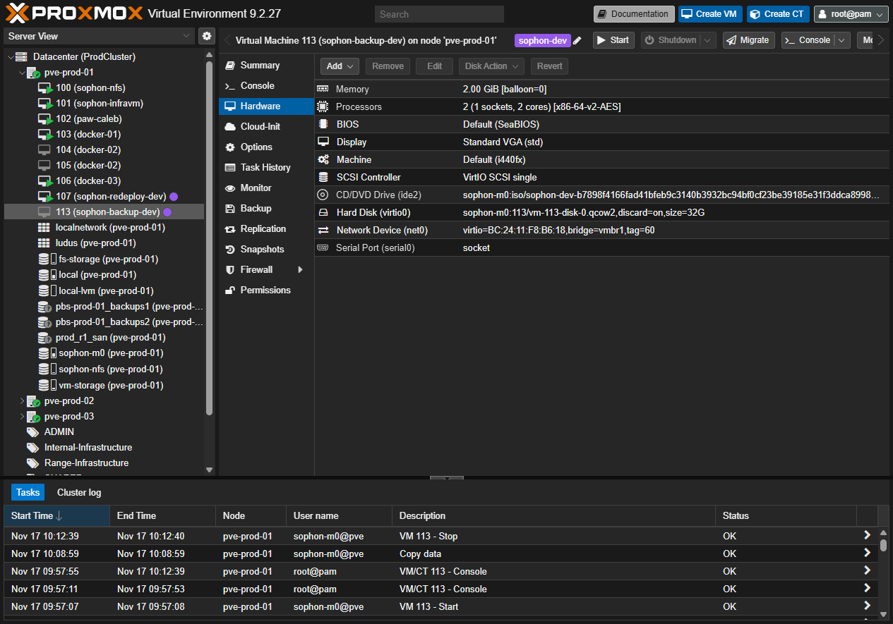
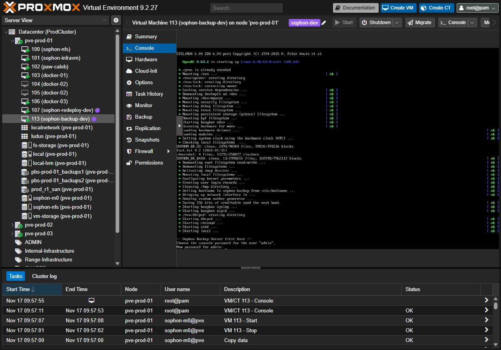
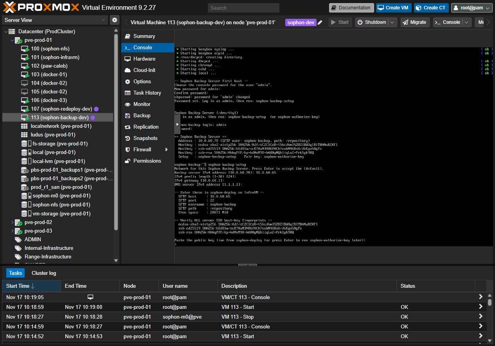

# Manual & Custom SFTP Backup Server Setup

Use this guide only if you are **not** using the default unattended `provision-backup` workflow from the [Operator Guide](./operator-guide.md).

- **Option A:** Boot a blank VM manually with `artifacts/backup/sophon-sftp-server.iso` and configure it interactively on the console.
- **Option B:** Point Sophon at an existing Linux server or NAS with a jailed OpenSSH `internal-sftp` configuration.

---

## Option A: Interactive VM Setup with `sophon-sftp-server.iso`

`bash sophon-provision.sh prepare` builds a secret-free hybrid BIOS + UEFI **Alpine 3.24 SFTP Backup Server ISO** at `artifacts/backup/sophon-sftp-server.iso`.

### 1. Create and boot the VM

1. Upload `artifacts/backup/sophon-sftp-server.iso` (`~133 MiB`) to your hypervisor.
2. Create a blank 64-bit Linux VM (`1–2` vCPU, `1–2 GiB` RAM, one blank disk of `16+ GiB`—for example `200+ GiB` for production, and one NIC on your backup VLAN/network).
3. Attach `sophon-sftp-server.iso` as a CD/DVD drive and set **boot order to the blank disk first, then the CD/DVD drive**.



4. Power on the VM and open its console. Because the disk starts blank, the installer partitions the disk, configures the jailed `sophon-backup` (`internal-sftp`) and read-only `sophon-restore` (`internal-sftp -R`) chroots under `/var/lib/sophon-backups/repository`, and reboots in ~20 seconds:



### 2. Set password & run `sophon-backup-setup`

1. Choose and confirm a console password for `admin`, then log in as `admin`.
2. Run `sophon-backup-setup` (without `sudo` or `doas`) and accept or enter your static IPv4 address, prefix, gateway, and DNS resolver:



3. Keep the console open for key authorization when running interactive `sophon-deploy` (see [Manual & Interactive InfraVM Installation](./manual-installation.md)), or run `sophon-authorize-key` (and `sophon-authorize-key --readonly` for a restore-drill key) at any time later.

---

## Option B: Existing Linux Server or NAS (`internal-sftp`)

To host the encrypted Kopia repository on an existing Debian, Ubuntu, or RHEL host instead of deploying `sophon-sftp-server.iso`, create confined read-write (`sophon-backup`) and read-only (`sophon-restore`) SFTP accounts:

```bash
sudo useradd --system --user-group --no-create-home \
    --home-dir /repository --shell /usr/sbin/nologin sophon-backup
sudo usermod -p '*' sophon-backup
sudo useradd --system --non-unique \
    --uid "$(id -u sophon-backup)" --gid "$(id -g sophon-backup)" \
    --no-create-home --home-dir /repository --shell /usr/sbin/nologin sophon-restore
sudo usermod -p '*' sophon-restore

sudo install -d -o root -g root -m 0755 /var/lib/sophon-backups /etc/ssh/authorized_keys
sudo install -d -o sophon-backup -g sophon-backup -m 0700 /var/lib/sophon-backups/repository
sudo install -o root -g root -m 0644 /dev/null /etc/ssh/authorized_keys/sophon-backup
sudo install -o root -g root -m 0644 /dev/null /etc/ssh/authorized_keys/sophon-restore

sudo tee /etc/ssh/sshd_config.d/50-sophon-backup.conf >/dev/null <<'EOF'
Match User sophon-backup
    AuthorizedKeysFile /etc/ssh/authorized_keys/sophon-backup
    ChrootDirectory /var/lib/sophon-backups
    ForceCommand internal-sftp
    PasswordAuthentication no
    KbdInteractiveAuthentication no
    AllowTcpForwarding no
    X11Forwarding no
    PermitTunnel no
    PermitTTY no
Match User sophon-restore
    AuthorizedKeysFile /etc/ssh/authorized_keys/sophon-restore
    ChrootDirectory /var/lib/sophon-backups
    ForceCommand internal-sftp -R
    PasswordAuthentication no
    KbdInteractiveAuthentication no
    AllowTcpForwarding no
    X11Forwarding no
    PermitTunnel no
    PermitTTY no
Match all
EOF

sudo chmod 0644 /etc/ssh/sshd_config.d/50-sophon-backup.conf
sudo sshd -t && sudo systemctl reload ssh
for pub in /etc/ssh/ssh_host_*_key.pub; do sudo ssh-keygen -lf "$pub"; done
```

- If you use unattended `bash sophon-provision.sh secrets`, copy the generated public keys from `~/.local/state/sophon/sftp/` (or authorize the `restrict ssh-ed25519 ...` lines printed during interactive `sophon-deploy`) into `/etc/ssh/authorized_keys/sophon-backup` and `/etc/ssh/authorized_keys/sophon-restore` (`root:root`, mode `0644`).
