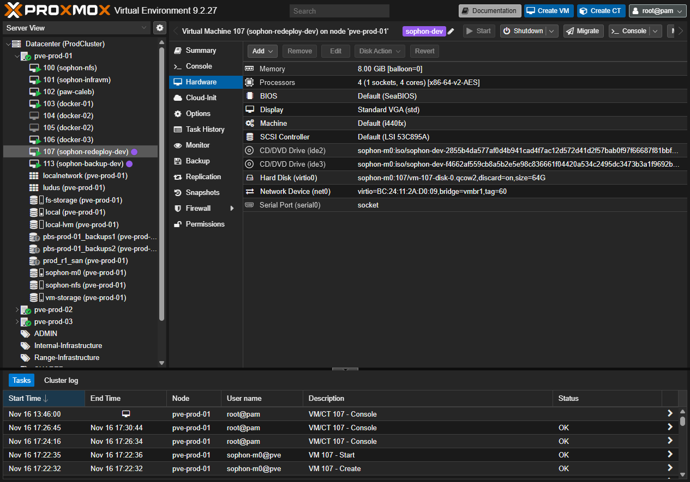
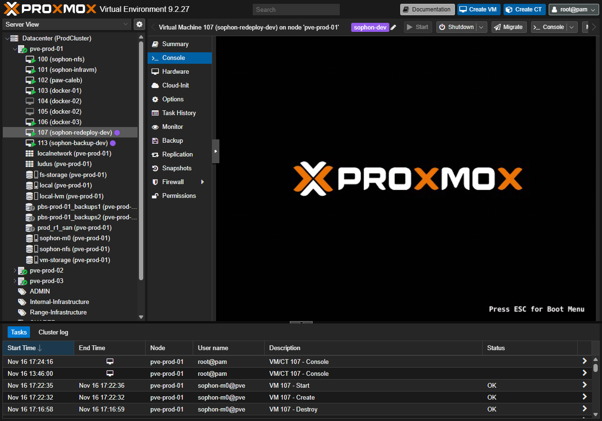
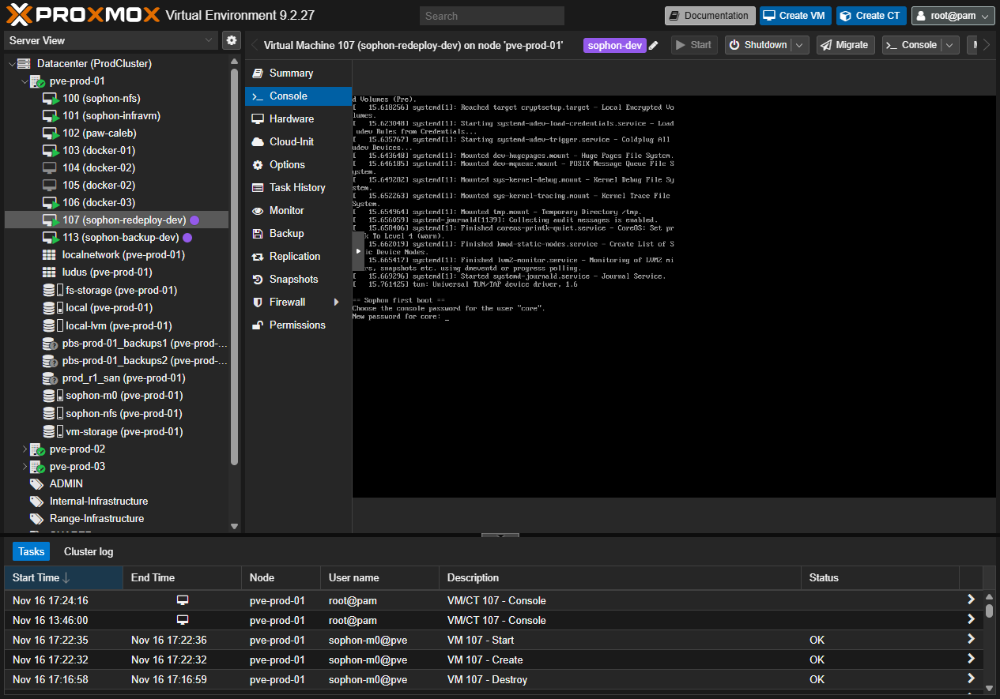
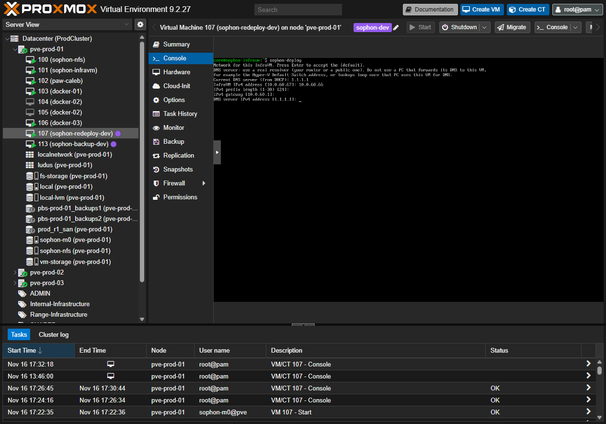
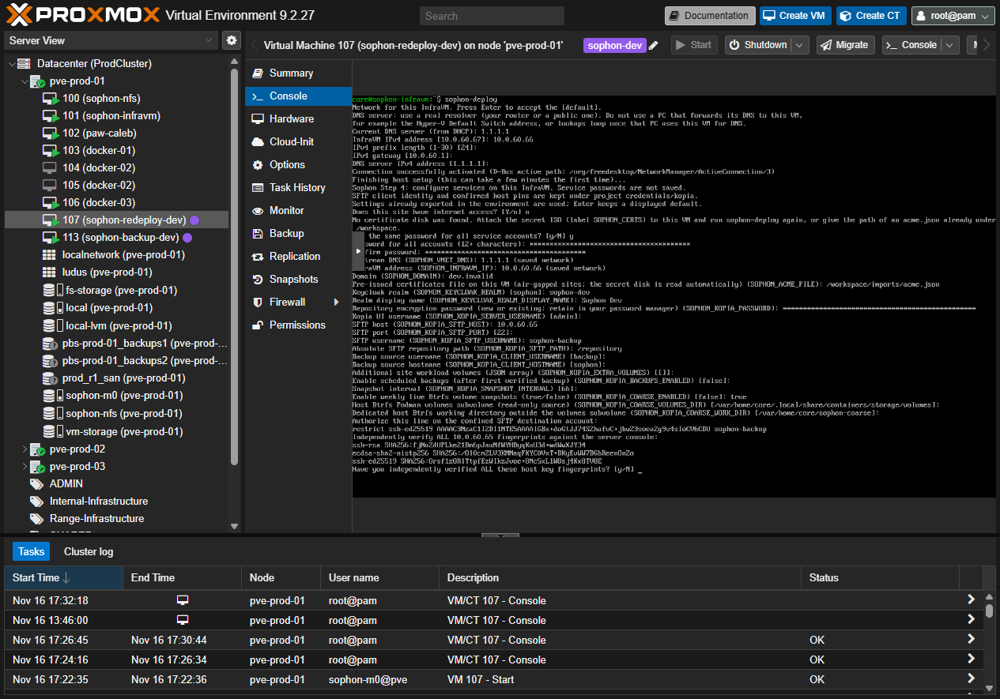
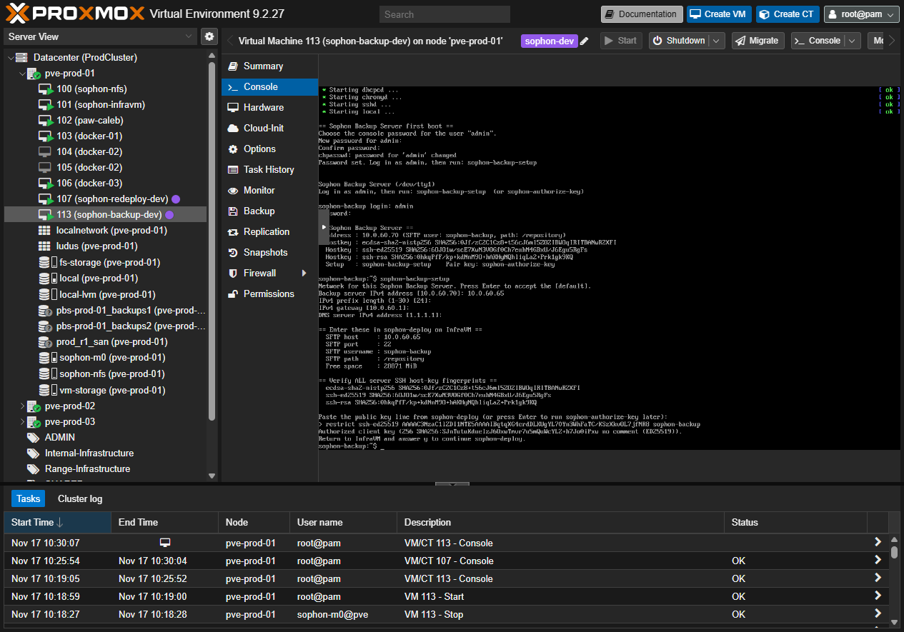
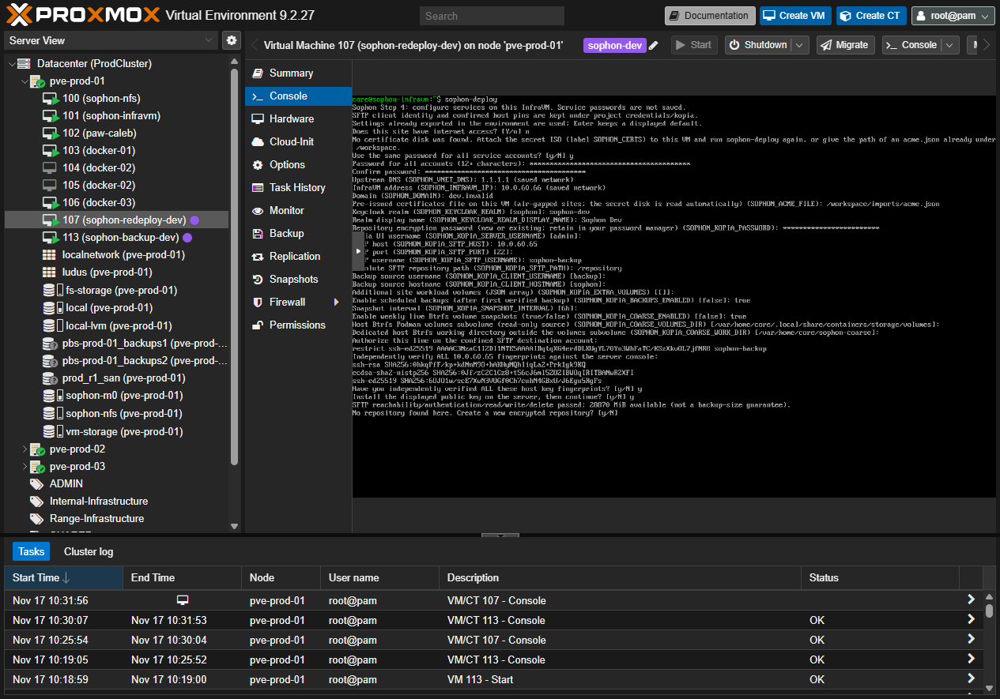
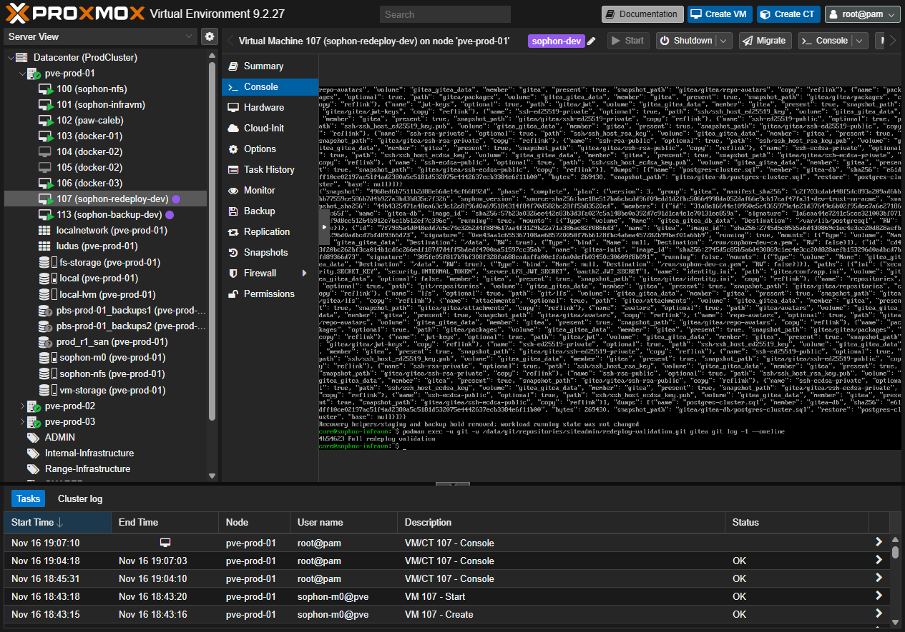

# Manual & Interactive InfraVM Installation and Recovery

Use this guide when deploying or recovering Sophon **without** hypervisor API automation or **without** an unattended `artifacts/secrets/sophon-secrets.iso` seed disk. For the standard automated workflow, see the [Operator Guide](./operator-guide.md).

---

## 1. Manual VM Creation (Any Hypervisor)

If you are creating InfraVM by hand (for example on VMware Workstation or an unmanaged host), first build the installation media on a machine with Docker or Podman:

```bash
bash sophon-provision.sh prepare          # Windows: .\sophon-provision.ps1 prepare
```

*(For air-gapped sites without internet access on the VM network, also run `bash sophon-provision.sh certificates issue --domain <your-domain>` to write your wildcard TLS certificate to `artifacts/secrets/sophon-secrets.iso`.)*

1. Copy `artifacts/coreos/sophon-coreos.iso` and `artifacts/bootstrap/sophon-apps.iso` (plus `artifacts/secrets/sophon-secrets.iso` if using pre-issued certificates or unattended seeding) to the hypervisor.
2. Create a 64-bit Linux VM (`8` vCPU, `8 GiB` RAM, one blank `40+ GiB` disk, and one NIC on your target network). On Hyper-V, use Generation 2 with Secure Boot disabled.
3. Attach the ISOs as CD/DVD drives and set **boot order to the blank disk first, then `sophon-coreos.iso`**.



4. Power on the VM. Because the disk is blank, Fedora CoreOS installs itself automatically, copies the offline Sophon bundle to `/var/lib/sophon`, and reboots:



---

## 2. Interactive First-Boot Setup (`sophon-deploy`)

When `sophon-secrets.iso` does not contain an unattended seed (or no secrets ISO is attached), InfraVM prompts you interactively on its console:

### 2.1 Choose the `core` password & configure static networking

1. At the first-boot prompt, set a local password for `core` and log in as `core`:



2. Run `sophon-deploy` (do **not** use `sudo`). Accept or enter the static IPv4 address, prefix length, gateway, and upstream DNS resolver (`1.1.1.1` or your firewall/router—never an address that forwards DNS back to InfraVM):



### 2.2 Enter site credentials & pair SFTP

1. Answer whether the site has internet access (`[Y/n]`), whether to share one `12+` character password across local service accounts (`[y/N]`), and enter your domain, Kopia encryption password (store this in your password manager), and SFTP target (`sophon-backup`, `/repository`).
2. `sophon-deploy` generates an `ed25519` client key, prints a `restrict ssh-ed25519 ...` line, and scans the SFTP server's host-key fingerprints:



3. Authorize that public key on your SFTP Backup Server (`sophon-authorize-key`; see [Manual Backup Server Setup](./manual-backup-server.md)):



4. Confirm the verified `SHA256` host-key fingerprints on InfraVM, confirm repository creation when `/repository` is empty, and wait for `sophon-deploy` to reconcile all stacks and complete the initial backup:



5. Eject the attached ISOs once `sophon-deploy` finishes.

---

## 3. Interactive Disaster Recovery (Without `sophon-secrets.iso`)

To recover from an existing SFTP Kopia repository without an unattended `sophon-secrets.iso`:

1. Boot a clean InfraVM (via `bash sophon-provision.sh provision` or Section 1 above), set the `core` password, and log in as `core`.
2. Stage the stacks in safe standby mode so public Cloudflare DNS/tunnels are untouched and scheduled backups stay paused before state is restored:
   ```bash
   sophon-deploy --prepare-restore
   ```
   Enter the same domain, realm, Kopia repository encryption password, and SFTP settings (`sophon-backup` if you plan to promote this VM to production afterward, or `sophon-restore` with `sophon-authorize-key --readonly` for a read-only test restore).
3. Restore all stateful services (`traefik`, `ldap`, `keycloak`, `gitea`) from the latest snapshot:
   ```bash
   sophon-restore
   ```



   *(To roll back a single service or select an older snapshot ID, use `sophon-restore --group gitea` or `sophon-restore --snapshot <SNAPSHOT_ID>`.)*

4. Verify your restored services in a browser (`https://arcane.<domain>` and `https://git.<domain>`).
5. If this VM is replacing production (and was paired with `sophon-backup`), promote it to live production:
   ```bash
   sophon-activate
   ```
   To switch its static IPv4 address from a temporary/dev IP to the production IP during promotion, pass `--network-cidr <prod-ip/prefix> --gateway <gw>`.
