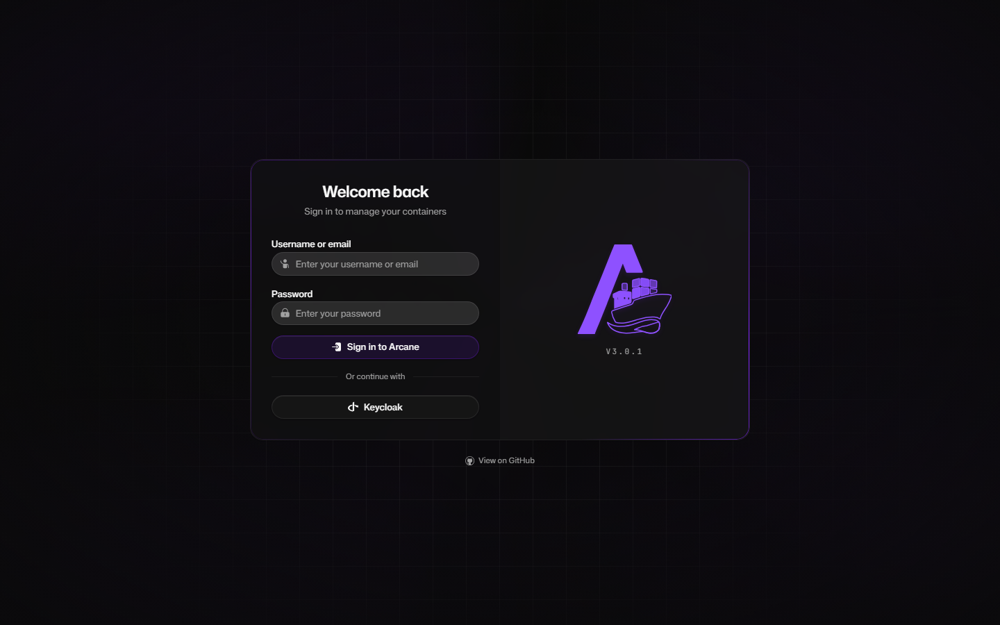
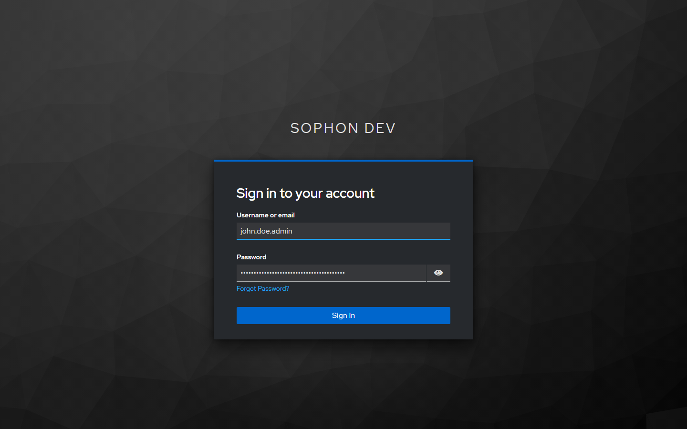
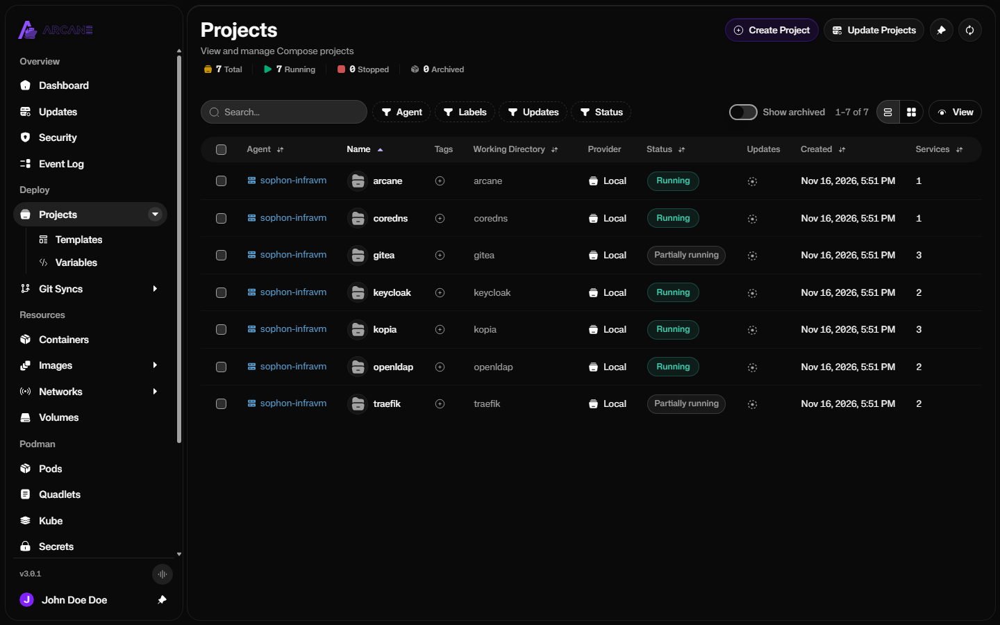

# Sophon Operations Guide

This guide covers the standard end-to-end workflow for deploying Sophon, verifying services, managing backups, running disaster-recovery drills or production cutovers, and performing monthly certificate renewals across Proxmox, VMware vCenter, and Microsoft Hyper-V.

- Need to set up the SFTP backup server manually or use an existing NAS/Linux host? See **[Manual & Custom SFTP Backup Server Setup](./manual-backup-server.md)**.
- Deploying without hypervisor API access or without an unattended secrets ISO? See **[Manual & Interactive InfraVM Installation and Recovery](./manual-installation.md)**.

---

## 1. Architecture Overview

Sophon runs on one **Fedora CoreOS** virtual machine (**InfraVM**) alongside an external SFTP backup server:

- **Immutable OS + persistent Btrfs storage:** Fedora CoreOS keeps the OS root read-only while storing container volumes on a persistent `/var` Btrfs partition so snapshots and restores can use fast copy-on-write reflinks.
- **Declarative rootless Podman stacks:** CoreDNS, Traefik, OpenLDAP, Keycloak, Gitea (with local file-backed Git LFS; built-in package registry disabled), Sonatype Nexus Repository (hosted + upstream proxy/group registries), Arcane, the LAN-only Appliance Status & Cutover UI (`https://<domain>` / `https://status.<domain>`), and Kopia run from Compose files in `/var/lib/sophon/stacks/`.
- **Sonatype Nexus Repository (`https://nexus.<domain>`, `https://registry.<domain>`, `https://registry-push.<domain>`):** Unified OCI container, PyPI, npm, APT, Maven, Cargo, and Raw artifact registry integrated natively with OpenLDAP (`nexus-admins`, `nexus-developers`). Proprietary `hosted` artifacts (including immutable `raw-vault` forensics/archive uploads and `raw-hosted` files) and PostgreSQL metadata are backed up by Kopia, while internet `proxy-cache` blobs and large re-obtainable `raw-scratch` blobs (`scratch` blob store) are excluded.
- **Arcane (`https://arcane.<domain>`) & Appliance Status UI (`https://<domain>`):** OIDC-authenticated UIs integrated with Keycloak (`arcane-admins` grants admin access). Arcane manages Compose stacks and Pure GitOps pull reconciliation ([`docs/nexus-and-gitops-plan.md`](./nexus-and-gitops-plan.md)), while `https://<domain>` (excluded from Cloudflare Tunnel publishing) shows appliance mode and provides one-click standby-to-production cutover and monthly TLS certificate updates.
- **Zero-downtime encrypted Kopia backups:**
  - **Primary backups (`/sophon-state`, default every `6h`):** Kopia's native scheduler and before/after snapshot actions capture hot database dumps (`pg_dumpall`, `pg_dump -Fc -Z0`, `slapcat`) via a restricted dump proxy and stage volume files (including Gitea Git + LFS data and TLS certificates) without stopping containers. Any container deployed via Gitea Actions can opt in with `sophon.backup.*` labels (see [`roles/kopia/README.md`](../roles/kopia/README.md)).
  - **Optional weekly Btrfs volume snapshots (`/sophon-coarse`, latest 4 kept):** Atomic read-only Btrfs subvolume snapshots uploaded weekly as a last-resort fallback.

> **Golden rule:** Nothing may exist only in the Arcane UI. Rebuilding a lost server is always **"deploy a clean VM from code, restore state from Kopia, and promote via `https://<domain>` (or `sophon-activate`)"**, never restoring a full-disk VM image.

---

## 2. Configure `.env` & Build ISOs

### 2.1 Pre-configure `.env` (Optional)

Pre-populating `.env` is **optional**—you can skip directly to [Section 2.2](#22-build-isos) and run `sh sophon-build-isos.sh`, which interactively prompts for any unset values and offers at the end to save your decisions to `.env` with `chmod 0600` permissions (`[Y/n]`, default **Yes**).

If you prefer to fill in settings ahead of time (or set optional hypervisor overrides before running `sh sophon-provision.sh`), copy `.env.example` to `.env`:

```sh
install -m 600 .env.example .env  # Windows PowerShell: Copy-Item .env.example .env
```

<details>
<summary>Notes: Optional hypervisor overrides, air-gapped sites, and <code>.env</code> reference</summary>

- `sh sophon-provision.sh` interactively prompts for core hypervisor connection details (Proxmox / vCenter / Hyper-V, host/URL, node/cluster/datastore/switch, and password), while optional hypervisor overrides—such as Proxmox API tokens (`SOPHON_PROXMOX_TOKEN_*`), non-default Proxmox storage pools (`SOPHON_PROXMOX_ISO_STORAGE` / `SOPHON_PROXMOX_DISK_STORAGE`), custom bridges, or VLAN tags (`SOPHON_VNET_VLAN`)—are configured via `.env` (or exported in your shell).
- Leave any password blank in `.env` if you prefer to enter it interactively; for air-gapped sites without internet on the VM network, leave `SOPHON_CF_TOKEN` blank (and see [Section 7](#7-monthly-certificate-renewal) for monthly certificate rotation).
- See [`.env.example`](../.env.example) and [`docs/inputs.md`](./inputs.md) for all hypervisor-specific fields.
- **Creating `SOPHON_CF_TOKEN` (Cloudflare API token):** At <https://dash.cloudflare.com/profile/api-tokens> > **Create Custom Token**, grant `Zone / Zone / Read`, `Zone / DNS / Edit`, and (when `SOPHON_CF_TUNNEL_ENABLED=true`) `Account / Cloudflare Tunnel / Edit`, scoped to your specific zone and account. Set `SOPHON_CF_TUNNEL_ENABLED=false` for LAN-only, dev, or standby VMs that issue DNS-01 certificates without creating a Cloudflare Tunnel or repointing public DNS CNAMEs.

</details>

### 2.2 Build ISOs

Build all Sophon ISOs:

```sh
sh sophon-build-isos.sh           # PowerShell: .\sophon-build-isos.ps1
```

<details>
<summary>Notes: What <code>sophon-build-isos.sh</code> generates, <code>.env</code> persistence, &amp; handling secrets ISOs</summary>

`sophon-build-isos.sh` prompts for any required values omitted from `.env`, writes your private mode-`0600` unattended secrets ISOs (`artifacts/secrets/sophon-secrets.iso`, plus `sophon-sftp-secrets.iso` with pre-paired read-write `sophon-backup` and read-only `sophon-restore` SSH keys whenever a paired Backup VM is selected or `SOPHON_BACKUP_NETWORK_CIDR` is set), builds the offline OS and app ISOs (`sophon-coreos.iso`, `sophon-apps.iso`, and `sophon-sftp-server.iso`), and prompts at the end (`[Y/n]`, default **Yes**) to persist your decisions to a mode-`0600` `.env` file for future runs.

Treat `.env` and `artifacts/secrets/*.iso` like passwords; delete `artifacts/secrets/*.iso` once your VMs are provisioned (or keep them solely on an encrypted admin workstation if running scheduled restore drills).

</details>

---

## 3. Provision Sophon

Deploy your Sophon VM(s) to the configured hypervisor:

```sh
sh sophon-provision.sh            # PowerShell: .\sophon-provision.ps1
```

<details>
<summary>Notes: What happens during provisioning &amp; separate backup-host options</summary>

When `artifacts/secrets/sophon-sftp-secrets.iso` exists, `sophon-provision.sh` ensures the Alpine SFTP Backup Server VM (`sophon-backup`) is running first and then deploys the production InfraVM (`sophon-infravm` on `SOPHON_NETWORK_CIDR`). To place the backup VM on a separate hypervisor or storage pool, deploy it there first with `sh sophon-provision.sh backup` or see [Manual & Custom SFTP Backup Server Setup](./manual-backup-server.md).

Both VMs install to disk, apply their static IPv4 settings and passwords, eject their secrets ISOs, and come up without console prompts:

- When `/repository` on the SFTP server is **empty**, `sophon-infravm` automatically initializes the encrypted Kopia repository, deploys all nine core stacks (plus `cloudflared` when enabled), runs and verifies the first backup, enables the `6h` backup schedule, and marks the VM console banner as `PRODUCTION ACTIVE`.
- When `/repository` **already contains snapshots**, InfraVM safely restores into **Safe Standby Mode** instead of overwriting backups or hijacking Cloudflare DNS (see [Section 6](#6-disaster-recovery--restore-drills)).

</details>

---

## 4. Access the Network & Verify Services

### 4.1 Reach the InfraVM network and configure client DNS

Depending on how your hypervisor VLANs are segmented, the subnet where you deployed InfraVM may not be directly routable from the laptop you used to talk to the hypervisor management API. Before opening the web UIs, make sure your client has a path to InfraVM's network—for example by:

- Connecting through an overlay network/VPN such as **Tailscale** or WireGuard,
- Moving your workstation onto that VLAN / swapping network cables, or
- Working from a privileged admin workstation VM inside that network.

Once on a reachable network, configure split-horizon DNS so queries for `<domain>` and `*.<domain>` go to InfraVM's IPv4 address (`SOPHON_NETWORK_CIDR`, or `SOPHON_DEV_NETWORK_CIDR` when testing a dev/drill VM) without sending all internet DNS through the VM:

- **Windows (and WSL2):** Run in an elevated PowerShell (WSL2 tunnels DNS through the Windows DNS Client, so this configures both Windows and WSL2 at once):

  ```powershell
  Add-DnsClientNrptRule -Namespace '.example.com','example.com' -NameServers '<VM address>'; Clear-DnsClientCache
  # undo: Get-DnsClientNrptRule | Where-Object { $_.Namespace -contains '.example.com' -or $_.Namespace -contains 'example.com' } | Remove-DnsClientNrptRule -Force; Clear-DnsClientCache
  ```

  Test with `Resolve-DnsName arcane.example.com` (`nslookup` on Windows ignores NRPT rules; inside WSL use `getent ahosts arcane.example.com`).

- **Linux (`systemd-resolved` 258+):** Add a domain-scoped DNS delegate (use `/etc/systemd/dns-delegate.d` instead of `/run/...` to persist across reboots; on non-WSL NixOS, enable `services.resolved.enable = true;` first):

  ```sh
  sudo mkdir -p /run/systemd/dns-delegate.d
  printf '[Delegate]\nDNS=<VM address>\nDomains=~example.com\n' | sudo tee /run/systemd/dns-delegate.d/sophon.dns-delegate >/dev/null
  sudo systemctl reload systemd-resolved
  # undo: sudo rm -f /run/systemd/dns-delegate.d/sophon.dns-delegate && sudo systemctl reload systemd-resolved
  ```

  Test with `resolvectl query arcane.example.com`.

*(Never point a host's global DNS resolver at InfraVM if InfraVM's upstream DNS forwards back to that host—such as Hyper-V `Default Switch`—or lookups will loop.)*

### 4.2 Verify Arcane SSO & Gitea

1. Open `https://arcane.<domain>` and click **Keycloak**:



2. Sign in through `https://auth.<domain>` as a member of `arcane-admins` (for example `john.doe.admin`):



3. Open **Deploy -> Projects** (`https://arcane.<domain>/projects`) to confirm all Sophon Compose stacks are healthy:



<details>
<summary>Note: Why stacks with init containers show <code>Partially running</code></summary>

Stacks with one-shot setup containers such as `gitea-init` and `traefik-init` normally show `Partially running` once those init containers exit `0`.

</details>

4. Open `https://git.<domain>` to verify Gitea SSO and repository/Git LFS hosting, and open `https://nexus.<domain>` (signing in with an OpenLDAP account in `nexus-admins` or `nexus-developers`, such as `john.doe.admin`) to verify pre-configured hosted, proxy, and group repositories (`registry.<domain>` for unified container pulls, `registry-push.<domain>` for CI pushes):


---

## 5. Backups & Kopia Web UI

### 5.1 Using the Kopia Web UI (`https://kopia.<domain>`)

Sign in at `https://kopia.<domain>` (`admin` by default) and switch the top-left filter from **Local Snapshots** to **All Snapshots** to view `/sophon-state` (and `/sophon-coarse` if enabled):


Click `/sophon-state` and choose any snapshot timestamp to browse directories or download individual files:


<details>
<summary>Notes: Kopia Web UI capabilities vs. InfraVM CLI</summary>

- **Supported in the Kopia Web UI:** Browsing snapshot history and sizes, downloading individual files, and clicking **Snapshot Now** on `/sophon-state` (which automatically runs Sophon's native before/after snapshot actions—hot database dumps, volume reflink staging, and cleanup).
- **Use the InfraVM CLI instead of the Web UI for:** Restoring containers (`sophon-restore` replays PostgreSQL/LDAP dumps and merges secrets; Kopia mounts `/volumes` read-only, so the UI **Restore** button cannot restore live containers) and changing snapshot policies (Sophon reconciles Kopia policies from code).

</details>

---

## 6. Disaster Recovery & Restore Drills

Sophon uses the same workflow for **routine restore drills** and **real disaster-recovery cutovers**: deploy a clean dev/standby VM from `sophon-secrets.iso`, verify the restored services on the dev IP, and—only when cutting over to production—promote it from the web UI at `https://<domain>` (or via `sophon-activate`).

### 6.1 Deploy or refresh the dev / restore-drill InfraVM

From your workstation, run:

```sh
sh sophon-provision-dev.sh        # PowerShell: .\sophon-provision-dev.ps1
```

- **For a restore drill:** You are done once the VM console banner reads `STANDBY RESTORE VERIFIED` (or after opening `https://<domain>`, `https://arcane.<domain>`, and `https://git.<domain>` against the dev IP)—leave the VM in Safe Standby Mode.
- **Optional weekly Linux schedule:** Enable the user timer in [`contrib/systemd/`](../contrib/systemd):
  ```sh
  mkdir -p ~/.config/systemd/user
  cp contrib/systemd/sophon-verify-restore.{service,timer} ~/.config/systemd/user/
  systemctl --user daemon-reload
  systemctl --user enable --now sophon-verify-restore.timer
  ```

<details>
<summary>Notes: What <code>sh sophon-provision-dev.sh</code> does under the hood &amp; <code>--wait-https</code></summary>

`sh sophon-provision-dev.sh` automatically:
1. Stops and deletes any existing `SOPHON_DEV_INFRAVM_NAME` (`sophon-dev-infravm`) VM on Proxmox, vCenter, or Hyper-V (while refusing to touch `SOPHON_INFRAVM_NAME` or `sophon-backup`).
2. Configures the new VM with `SOPHON_DEV_NETWORK_CIDR` (using that dev IP as its own DNS address) and the confined read-only `sophon-restore` SFTP key, while keeping your production IP and `sophon-backup` credentials staged privately on the host for optional promotion.
3. Installs CoreOS, deploys all stacks in **Safe Standby Mode** (Cloudflare tunnel disabled, Kopia `--readonly`, scheduled backups paused), runs `sophon-restore --snapshot latest --yes`, reconciles any pure GitOps workload stacks from local `ops/workloads` (`sophon-reconcile-gitops --standby --restore-data`), verifies all containers and HTTPS endpoints locally inside the guest, and sets the console banner to `STANDBY RESTORE VERIFIED`.

Append `--wait-https` if your workstation can reach `SOPHON_DEV_NETWORK_CIDR` over `:443` and you want the command to wait until external HTTPS checks pass.

</details>

### 6.2 Promote to live production (`https://<domain>`)

When recovering from an actual production outage:

1. Delete (or power off) the old production VM so its IP address (`SOPHON_NETWORK_CIDR`) is free on the network:
   ```sh
   sh sophon-destroy-vm.sh        # PowerShell: .\sophon-destroy-vm.ps1
   ```
2. Point client DNS for `<domain>` at the restored standby VM (`SOPHON_DEV_NETWORK_CIDR`), open **`https://<domain>`** (or `https://status.<domain>`), sign in with Keycloak SSO (`arcane-admins`), and click **Promote to Active Production**.
   - **Automatic IP-conflict lock:** While the production IP (`SOPHON_NETWORK_CIDR`) is still responding on the network, **Promote to Active Production** remains disabled (grayed out) to prevent an IP collision against a live production VM. Once step 1 shuts down the old VM, the button unlocks automatically within seconds (or click **Re-check Production IP**), and update your client DNS back to `SOPHON_NETWORK_CIDR` once cutover switches the NIC.

<details>
<summary>Notes: How web cutover works, CLI fallback (<code>sophon-activate</code>), &amp; alternative recovery options</summary>

- **LAN-only cutover UI & detached host promotion:** `https://<domain>` and `https://status.<domain>` are explicitly excluded from Cloudflare Tunnel publishing (`CF_EXCLUDE`), require a verified Keycloak session in `arcane-admins`, and never mount secret tokens or the Podman socket inside the web container. Clicking **Promote to Active Production** triggers a detached host `systemd` unit (`sophon-web-activate.service`) that runs `sophon-activate --yes`, so switching the VM's NIC from `SOPHON_DEV_NETWORK_CIDR` to `SOPHON_NETWORK_CIDR` mid-cutover never interrupts activation.
- **What promotion updates (`sophon-activate`):** Re-verifies that `SOPHON_NETWORK_CIDR` is unoccupied on the network, switches the VM's static IPv4 address and self-pointing DNS (CoreDNS, Podman network resolvers, and stack `extra_hosts` mappings) from `SOPHON_DEV_NETWORK_CIDR` to `SOPHON_NETWORK_CIDR`, switches Kopia from read-only `sophon-restore` to read-write `sophon-backup`, enables `cloudflared` if configured, runs and verifies an immediate backup, and marks the server `PRODUCTION ACTIVE`.
- **CLI fallback:** You can also SSH or console in as `core` and run `sophon-activate` directly (which enforces the same live IP-occupancy preflight check).
- **Alternative—replace the production VM directly in place:** If you prefer to rebuild `sophon-infravm` directly on `SOPHON_NETWORK_CIDR` instead of promoting `sophon-dev-infravm`, run `sh sophon-provision.sh --recreate` (which confirms, deletes `sophon-infravm`, and boots a fresh `sophon-infravm` into Safe Standby Mode), then promote via `https://<domain>` or `sophon-activate`.
- **Recovering without `sophon-secrets.iso`:** Follow [Interactive Disaster Recovery in Manual Installation](./manual-installation.md#3-interactive-disaster-recovery-without-sophon-secretsiso).

</details>

---

## 7. Monthly Certificate Renewal

Sophon uses a single Let's Encrypt ECDSA P-256 wildcard certificate (`<domain>` and `*.<domain>`, valid for **90 days**) stored in Traefik's `acme.json` and shared automatically with LDAPS and Nexus registry trust.

<details>
<summary>Notes: Connected vs. air-gapped InfraVMs, 65-day renewal window, &amp; forcing early renewal</summary>

- **Connected InfraVMs (`SOPHON_CF_TOKEN` configured on InfraVM):** Traefik automatically renews the wildcard certificate via Cloudflare DNS-01 ~30 days before expiry, `certs-dumper` updates `ldap_certs`, and Kopia backs up `/data/acme.json` every `6h`—no monthly InfraVM maintenance is required. *(You only need Step 7.1 if you keep an offline `sophon-secrets.iso` on an encrypted workstation and want its embedded certificate refreshed.)*
- **Air-gapped / offline InfraVMs (no `SOPHON_CF_TOKEN` or internet on the VM network):** InfraVM cannot contact Let's Encrypt on its own. Run the workflow below **every month** so the live certificate and your recovery ISO never approach their 90-day expiry.
- **Automatic 65-day reuse window:** On the workstation, `sophon-build-isos.sh` inspects `/state/certificates/<domain>/acme.json` inside the `sophon-state` container volume. When **65 days or fewer** remain (any monthly run ~25+ days after the previous issue), it automatically runs a temporary local Traefik DNS-01 challenge and issues a fresh 90-day wildcard certificate; when **more than 65 days** remain, it reuses the cached certificate so repeated runs within the same week never hit Let's Encrypt's 5-per-week duplicate certificate limit.
- **Forcing an early 90-day renewal (`--renew-certs`):** Append `--renew-certs` (`sh sophon-build-isos.sh --renew-certs` / `.\sophon-build-isos.ps1 --renew-certs`) if you ever want to issue a brand-new 90-day certificate when more than 65 days still remain (for example right before an extended offline window).
- **Back up `sophon-state`:** Back up the workstation's `sophon-state` volume (`docker run --rm -v sophon-state:/state -v "$(pwd):/workspace" sophon-tools tar -czf sophon-state.tgz -C /state .`) to preserve your ACME account key across workstation rebuilds.

</details>

### 7.1 Renew the wildcard certificate & rebuild `sophon-secrets.iso`

From the **same connected workstation** each month, run:

```sh
sh sophon-build-isos.sh           # PowerShell: .\sophon-build-isos.ps1
```

*(Uses your saved `.env` settings, prompts privately for a Cloudflare DNS API token with `Zone:Read` + `DNS:Edit` if not set in your environment, issues a fresh 90-day wildcard certificate when ≤65 days remain, and rebuilds `artifacts/secrets/sophon-secrets.iso` with both `/acme.json` and `/sophon-seed.json` while skipping unchanged OS/app ISOs.)*

### 7.2 Mount `sophon-secrets.iso` & apply in `https://<domain>`

1. Hot-attach the renewed `sophon-secrets.iso` to `sophon-infravm` (and automatically delete the local workstation ISO copy once uploaded; pass `--keep-local` / `-KeepLocal` if you also keep `sophon-secrets.iso` on an encrypted workstation for `sophon-provision-dev.sh` restore drills):
   ```sh
   sh sophon-mount-secrets.sh     # PowerShell: .\sophon-mount-secrets.ps1
   ```
2. Open **`https://<domain>`** (or `https://status.<domain>`), sign in with Keycloak SSO (`arcane-admins`), and click **Update Certificates** in the **TLS Certificate Management** card.
   - **Automatic validation & cleanup:** **Update Certificates** remains disabled until a valid `SOPHON_CERTS` disk is attached (click **Scan Certificate Disk** if needed). Clicking it validates the new certificate chain and key, updates Traefik, reloads `certs-dumper`, OpenLDAP (LDAPS), and host Podman registry trust, triggers an immediate Kopia backup snapshot, and automatically ejects `sophon-secrets.iso` from the VM's CD/DVD drive.

<details>
<summary>Notes: How one-click certificate rotation works &amp; CLI fallback (<code>sophon-refresh-certs</code>)</summary>

- **Cross-hypervisor hot-mount & storage hygiene (`sophon-mount-secrets.sh`):** Verifies `/acme.json` locally before touching the hypervisor, uploads `sophon-secrets-<sha8>.iso` to Proxmox, VMware vCenter, or Microsoft Hyper-V, inserts it into `sophon-infravm`'s virtual CD/DVD drive without rebooting the VM, prunes superseded `sophon-secrets-*.iso` uploads from hypervisor storage, and removes the local `artifacts/secrets/sophon-secrets.iso` file unless `--keep-local` is passed. (Target another Sophon VM such as `sophon-dev-infravm` with `--vm-name sophon-dev-infravm`.)
- **Zero-password detached host rotation:** Clicking **Update Certificates** triggers a detached host `systemd` unit (`sophon-web-refresh-certs.service` -> `/usr/local/bin/sophon-refresh-certs`) outside Podman containers so restarting Traefik never interrupts the rotation or requires re-entering service passwords. If Traefik fails to start with the new store, Sophon automatically restores the previous `acme.json`.
- **CLI / expired-certificate console fallback (`sophon-refresh-certs`):** If an air-gapped certificate was allowed to expire completely before renewal (preventing browser HTTPS or Keycloak LDAPS sign-in), run `sh sophon-mount-secrets.sh`, log in to the InfraVM console as `core`, and run `sophon-refresh-certs` directly (do **not** use `sudo`). It performs the exact same validation, Traefik + OpenLDAP reload, Kopia snapshot, and CD-ROM eject with zero password prompts. For additional background on the wildcard store format, see [`docs/certificates.md`](./certificates.md).

</details>


