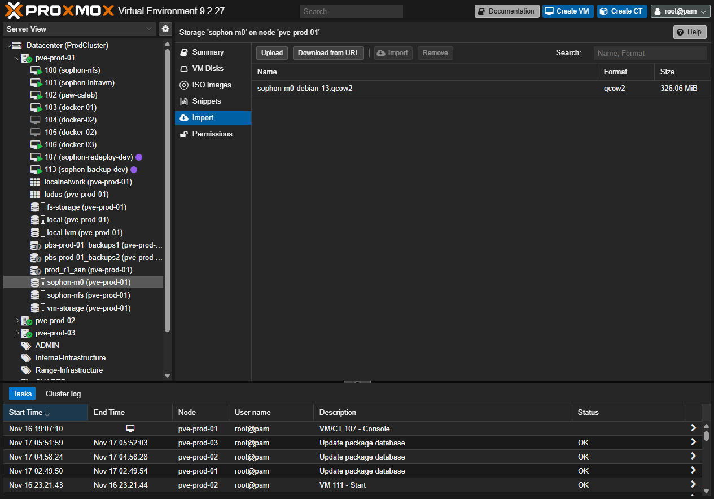
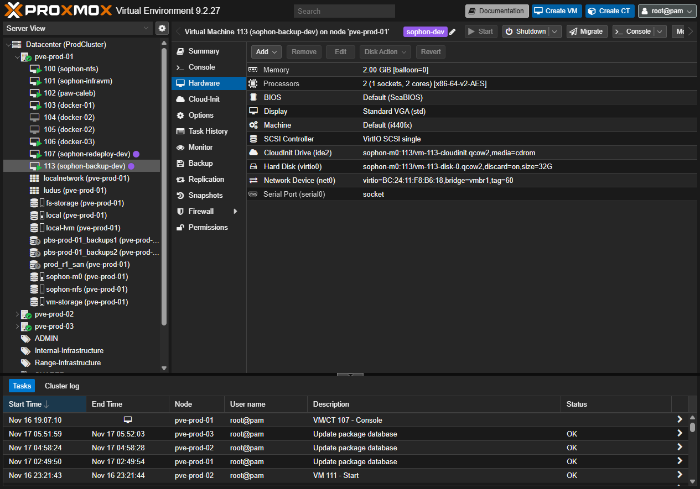
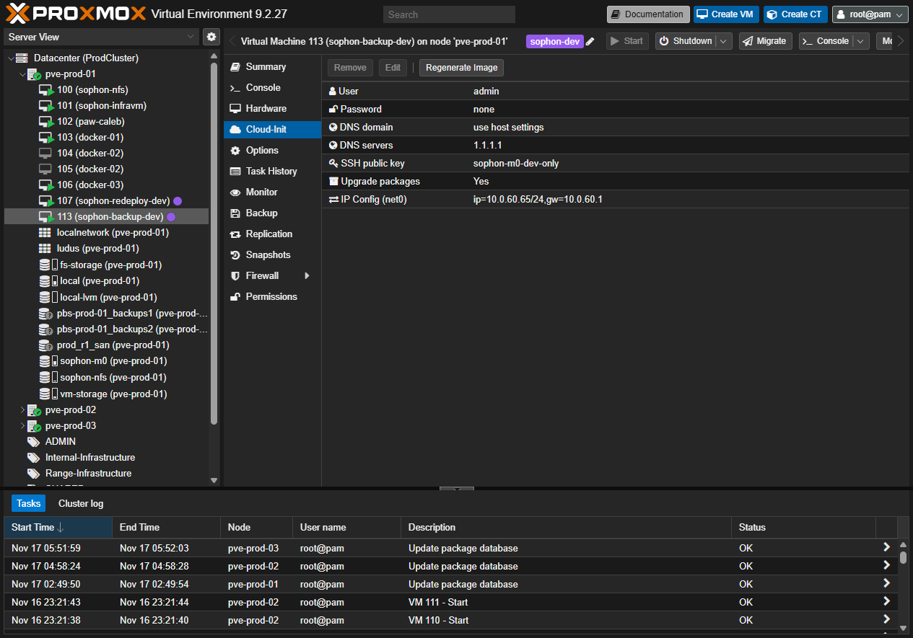
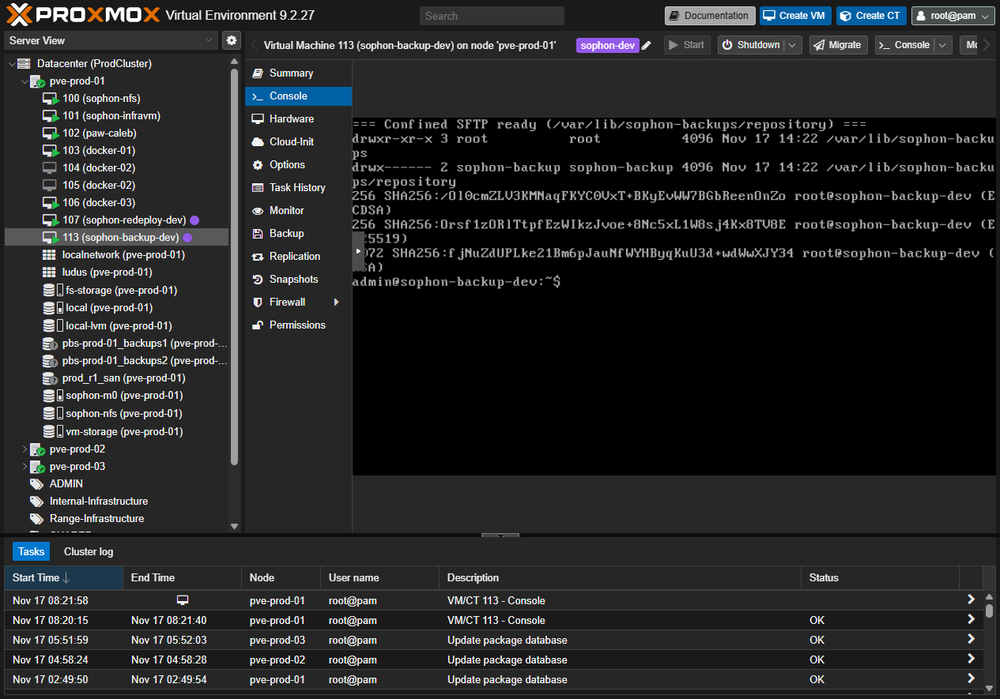
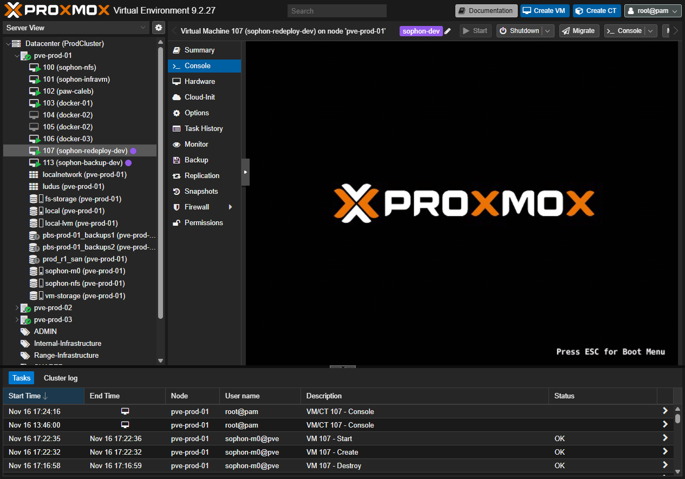
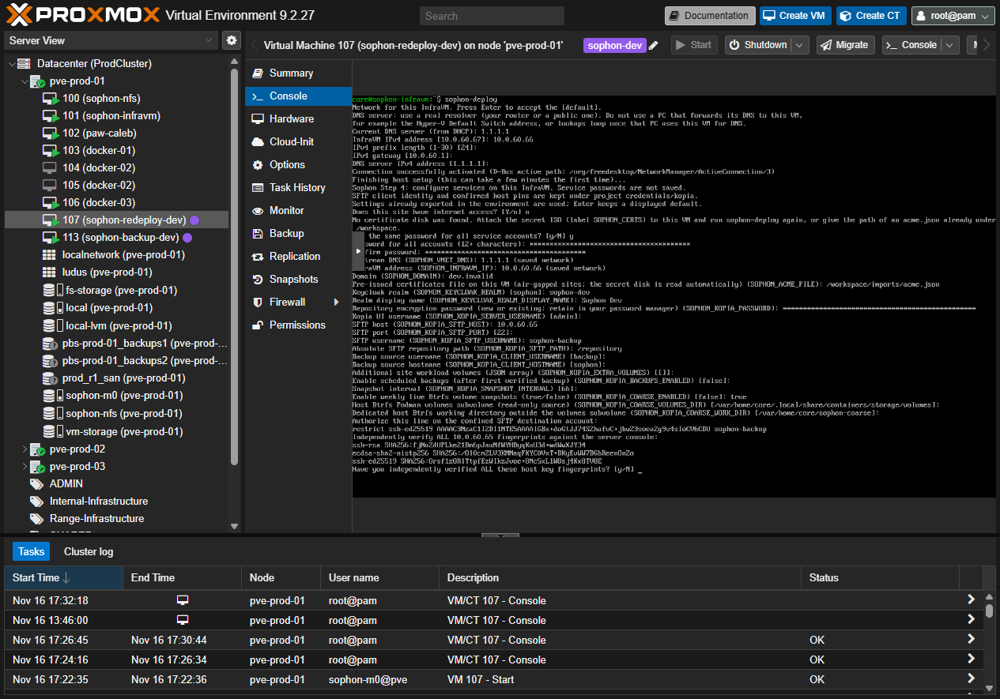
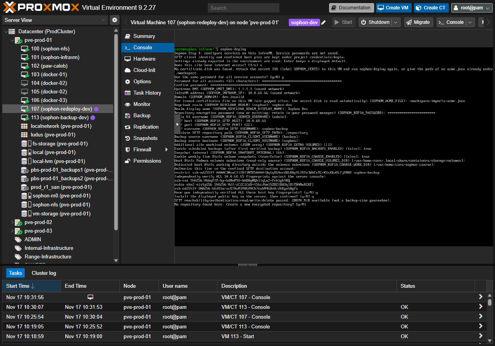
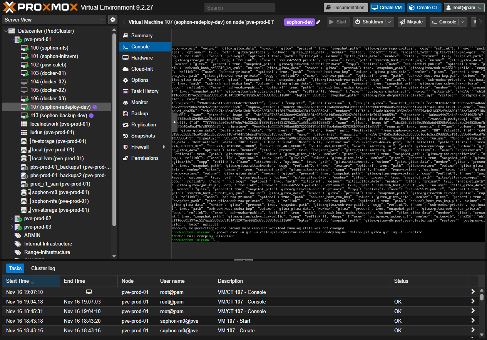

# Sophon Installation, Operations & Disaster Recovery Guide

This walkthrough shows every human-facing step required to stand up a clean SFTP backup target, install Sophon onto a blank virtual machine, complete interactive console configuration (`sophon-deploy`), verify Day-1 SSO and container management in **Arcane**, enable zero-downtime backups, and recover full application state onto a freshly wiped VM (`sophon-restore`).

---

## 1. Architecture & Operating Principles

Sophon runs on a single **Fedora CoreOS** virtual machine (**InfraVM**) with a dual-partition persistent layout:

- **Partition 4 (`root`, `8 GiB` XFS):** Immutable OSTree operating system root.
- **Partition 5 (`sophon-var`, remaining disk, Btrfs):** Persistent `/var` mounted with `noatime,user_subvol_rm_allowed`. During first-boot host setup, `/var/home/core/.local/share/containers/storage/volumes` is created as a dedicated **Btrfs subvolume** (`inode=256`).
- **Declarative Compose stacks (`/var/lib/sophon/stacks/<stack>/compose.yaml`):** Deployed directly over the rootless Podman socket without routing deployment through any web UI.
- **Arcane (`https://arcane.<domain>`):** Open-source container management UI authenticated via Keycloak OIDC (`arcane-admins` LDAP group maps to `role_admin`).
- **Two-tier encrypted Kopia backups over confined SFTP:**
  1. **Primary backups (`backup@sophon:/sophon-state`, default every `6h`):** Captures only irreproducible application state (user repositories, generated application identity keys, ACME certificates) and native database logical exports (`pg_dumpall`, `slapcat`).
  2. **Optional weekly live volume snapshots (`backup@sophon:/sophon-coarse`, latest 4 kept):** Creates an atomic, read-only Btrfs subvolume snapshot (`BTRFS_IOC_SNAP_CREATE_V2`) of the Podman `volumes` subvolume with **zero container stops**, uploads to SFTP, and destroys the local snapshot. Last-resort use only.

> **Golden rule:** Sophon is infrastructure as code. Nothing may exist only in the Arcane UI. Rebuilding a lost server is always **"rerun `sophon-deploy` on a clean VM, then restore application state with `sophon-restore`"**, never restoring a full-disk VM image.

---

## 2. Create & Configure a Confined SFTP Backup Server from Scratch

Sophon stores encrypted Kopia snapshots on an external SFTP server (preferably on a separate physical host, NAS, or storage pool from InfraVM so backups survive storage or host loss). You do **not** need to generate SSH client keys or `known_hosts` files by hand—InfraVM generates its own `ed25519` client identity and scans the server's host keys interactively.

If you already have an existing Linux host or NAS, skip straight to **Section 2.2**. If you do **not** yet have a backup server, follow **Section 2.1** to provision a clean Debian 13 Cloud-Init VM in Proxmox VE in under two minutes.

### 2.1 Provision a new Debian 13 SFTP backup VM (Proxmox VE)

#### Step A — Import the official Debian 13 Cloud-Init image

1. In the Proxmox web UI, select a storage pool that has **Import** enabled (Datacenter -> Storage -> Edit -> Content: include `Import`, `Disk image`, `ISO image`), then open its **Import** tab.
2. Click **Download from URL**, paste the official Debian 13 (`trixie`) generic cloud image URL, click **Query URL**, and download it:
   - URL: `https://cloud.debian.org/images/cloud/trixie/latest/debian-13-genericcloud-amd64.qcow2`
   - Verify the SHA-512 checksum against `https://cloud.debian.org/images/cloud/trixie/latest/SHA512SUMS` (`Hash algorithm: sha512`).



#### Step B — Create the VM, resize disk & attach Cloud-Init

You can create the backup VM either in the Proxmox GUI or with `qm` on the Proxmox node:

- **Option 1 — Proxmox GUI:**
  1. Select the downloaded `.qcow2` row in **Import** and click **Import** (or click **Create VM** -> **OS: Do not use any media**, **System: VirtIO SCSI single**, `2` cores `x86-64-v2-AES`, `2048 MiB` RAM, **Network: VirtIO** on your target bridge/VLAN, and import the disk onto **Hard Disk (`virtio0`)** with `Discard` enabled).
  2. In the VM's **Hardware** tab, select **Hard Disk (`virtio0`)** -> **Disk Action -> Resize** and grow the disk to your desired backup capacity (for example `+30G` for a `32 GiB` dev target, or `200G+` for production).
  3. Click **Add -> CloudInit Drive** on your target storage, and add **Add -> Serial Port (`serial0`)** if desired. Check **Options -> Boot Order** so `virtio0` is enabled first.



  4. Open the VM's **Cloud-Init** tab and set:
     - **User:** `admin`
     - **DNS servers:** `1.1.1.1` (or your upstream resolver)
     - **SSH public key:** paste your operator workstation's SSH public key (for administrative access to set up the confined SFTP account)
     - **IP Config (`net0`):** Static IPv4 address and gateway on the backup network (for example `10.0.60.65/24`, gateway `10.0.60.1`)
  5. Click **Regenerate Image**, then click **Start** at the top right.



- **Option 2 — Proxmox `qm` CLI equivalent (run on the Proxmox node):**

  ```bash
  VMID=113
  STORAGE=your-backup-storage
  BRIDGE=vmbr1
  VLAN=60
  BACKUP_IP=10.0.60.65/24
  GATEWAY=10.0.60.1

  qm create "$VMID" --name sophon-sftp --cores 2 --memory 2048 --balloon 0 \
      --cpu x86-64-v2-AES --ostype l26 --scsihw virtio-scsi-single \
      --net0 "virtio,bridge=${BRIDGE},tag=${VLAN}" \
      --virtio0 "${STORAGE}:0,import-from=${STORAGE}:import/debian-13-genericcloud-amd64.qcow2,format=qcow2,discard=on" \
      --ide2 "${STORAGE}:cloudinit" --ciuser admin --sshkeys ~/.ssh/authorized_keys \
      --ipconfig0 "ip=${BACKUP_IP},gw=${GATEWAY}" --nameserver 1.1.1.1 \
      --boot order=virtio0 --serial0 socket --vga std
  qm disk resize "$VMID" virtio0 100G
  qm start "$VMID"
  ```

### 2.2 Configure the confined OpenSSH `internal-sftp` chroot

SSH into the backup server (`ssh admin@<backup-server-ip>`) and create a locked `sophon-backup` system account jailed inside `/var/lib/sophon-backups` with `ForceCommand internal-sftp`:

```bash
# 1. Create a locked system user with no interactive shell
sudo useradd --system --user-group --no-create-home \
    --home-dir /repository --shell /usr/sbin/nologin sophon-backup
sudo usermod -p '*' sophon-backup

# 2. Create the root-owned chroot directory and writable repository subdirectory
#    (OpenSSH requires ChrootDirectory itself to be owned by root:root, mode 0755)
sudo install -d -o root -g root -m 0755 /var/lib/sophon-backups /etc/ssh/authorized_keys
sudo install -d -o sophon-backup -g sophon-backup -m 0700 /var/lib/sophon-backups/repository
sudo install -o root -g root -m 0600 /dev/null /etc/ssh/authorized_keys/sophon-backup

# 3. Confine sophon-backup to internal-sftp inside /var/lib/sophon-backups
sudo tee /etc/ssh/sshd_config.d/50-sophon-backup.conf >/dev/null <<'EOF'
Match User sophon-backup
    AuthorizedKeysFile /etc/ssh/authorized_keys/sophon-backup
    ChrootDirectory /var/lib/sophon-backups
    ForceCommand internal-sftp
    PasswordAuthentication no
    KbdInteractiveAuthentication no
    AllowTcpForwarding no
    X11Forwarding no
    PermitTunnel no
    PermitTTY no
Match all
EOF
sudo chmod 0644 /etc/ssh/sshd_config.d/50-sophon-backup.conf
sudo sshd -t && sudo systemctl reload ssh

# 4. Print the server's SSH host-key SHA256 fingerprints for out-of-band verification
for pub in /etc/ssh/ssh_host_*_key.pub; do sudo ssh-keygen -lf "$pub"; done
```



Keep those `SHA256:...` fingerprints visible so you can compare them when `sophon-deploy` scans the backup server. Because `ChrootDirectory` is `/var/lib/sophon-backups`, the SFTP path you enter in `sophon-deploy` is `/repository`.

---

## 3. Build Media & Boot InfraVM

On your workstation (with Docker or Podman installed), run:

```bash
bash sophon-provision.sh          # Windows PowerShell: .\sophon-provision.ps1
```

If you are creating the VM manually on Proxmox, vCenter, Hyper-V, or Workstation after running `bash sophon-provision.sh prepare`:

1. Upload `artifacts/coreos/sophon-installer.iso` and `artifacts/bootstrap/sophon-deployment.iso` (plus `artifacts/secrets/sophon-certificates.iso` for air-gapped sites).
2. Create a blank 64-bit Linux VM (`4+` vCPU, `8 GiB` RAM, one blank `40+ GiB` disk—`64 GiB` recommended with `discard=on`, and one NIC on your target VLAN/network).
3. Attach both ISOs as CD/DVD drives and set **boot order to the blank disk first, then the installer ISO**.


Power on the VM and open its console. Because the disk starts blank, firmware falls through to `sophon-installer.iso`. `sophon-autoinstall` automatically mounts `SOPHON_DEPLOY`, writes Fedora CoreOS to disk, resizes `root` to `8 GiB`, formats the remaining space as Btrfs (`sophon-var`), copies the offline Sophon bundle into `/var/lib/sophon`, and reboots into the installed OS—no typing required:



---

## 4. First Boot & Interactive `sophon-deploy`

### 4.1 Set the console password for `core`

On first boot, `sophon-set-password.service` locks console login until you choose a local password for `core`:


Enter and confirm the password, then log in at the prompt as `core`.

### 4.2 Configure static networking

Run `sophon-deploy` (do **not** use `sudo`). On its first run, `sophon-network` detects the current DHCP lease and offers its IPv4 address, prefix length, and gateway as defaults alongside `1.1.1.1` for upstream DNS:


> **Important:** Always use a real upstream DNS resolver (your upstream router/firewall or `1.1.1.1`), never a workstation or Hyper-V Default Switch IP that forwards DNS back to InfraVM.

After applying the static address, `sophon-deploy` finishes host bootstrap (`sophon-host-bootstrap.service`), creating the Btrfs `volumes` subvolume and loading the offline `sophon:latest` runner image.

### 4.3 Service settings, SFTP pairing & preflight

`sophon-deploy` then prompts for site settings (each secret input echoes `*` and is never persisted to disk):

1. **Internet access (`[Y/n]`):** Keep **Y** for connected sites (Let's Encrypt DNS-01 + optional Cloudflare tunnel), or answer **n** for air-gapped/offline sites using a pre-issued `acme.json` (`SOPHON_CERTS` disk).
2. **Shared service password (`[y/N]`):** Answer **y** if you want to enter one `12+` character password once for local admin/database accounts, or **n** to enter separate passwords per service. Note that the **Kopia repository encryption password** is always entered separately—store it in your password manager, as backups cannot be decrypted without it.
3. **Backup target (`SOPHON_KOPIA_SFTP_*`):** Enter your SFTP server IP/hostname, port (`22`), username (`sophon-backup`), and chroot-relative path (`/repository`). Leave `SOPHON_KOPIA_BACKUPS_ENABLED` at `false` until you verify your first snapshot (or enable `SOPHON_KOPIA_COARSE_ENABLED=true` if you also want weekly live Btrfs volume snapshots).

Before deploying any container stack, `sophon-deploy` generates `/var/lib/sophon/project/credentials/kopia/id_ed25519` (`0600`), prints a ready-to-paste `authorized_keys` line, and scans the SFTP server's SSH host keys:



1. Compare **all** displayed `SHA256:...` fingerprints against Step 2's output from the backup server console, then type `y`.
2. On the backup server, install the displayed `restrict ssh-ed25519 ...` line into `/etc/ssh/authorized_keys/sophon-backup`:

   ```bash
   printf '%s\n' 'restrict ssh-ed25519 AAAAC3NzaC1lZDI1NTE5AAAA... sophon-backup' \
       | sudo tee /etc/ssh/authorized_keys/sophon-backup >/dev/null
   sudo chmod 0644 /etc/ssh/authorized_keys/sophon-backup
   ```

3. Return to the InfraVM console and type `y` at `Install the displayed public key on the server, then continue? [y/N]`.
4. Sophon immediately verifies SFTP authentication, read/write/delete integrity, and free space (`statvfs@openssh.com`), checks whether a Kopia repository already exists at `/repository`, and—only when the path is empty—asks before creating a new encrypted repository:



Confirm with `y`. Ansible (`4-configure.yml`) then reconciles all core Compose projects (`coredns`, `traefik`, `openldap`, `keycloak`, `gitea`, `arcane`, and `kopia`) and waits for health checks to pass. On the backup server, `/var/lib/sophon-backups/repository` now contains the encrypted Kopia repository shards owned by `sophon-backup:sophon-backup`:


Once `sophon-deploy` finishes, detach the installer and deployment ISOs from InfraVM.

---

## 5. Day-1 Verification & Web UI Tour

Point your client machine's DNS for your Sophon domain at InfraVM's IPv4 address (see [split-horizon DNS instructions](../README.md#using-the-services)), then open `https://arcane.<domain>`:


Click **Keycloak** to authenticate through Sophon's central SSO (`https://auth.<domain>`):


Signing in as an LDAP member of `arcane-admins` (for example the seeded `john.doe.admin` account) grants global `role_admin` access in Arcane automatically. Open **Deploy -> Projects** (`https://arcane.<domain>/projects`) to inspect all seven Compose projects discovered from `/var/lib/sophon/stacks`:


> **Note on `Partially running` status:** Stacks such as `gitea` and `traefik` include one-shot initialization containers (`gitea-init`, `traefik-init`) that seed configuration and exit `0`. Arcane accurately reports those stacks as `Partially running` while all long-running service containers remain healthy.

Next, verify Git hosting at `https://git.<domain>` (using **Sign In With Keycloak** or the `siteadmin` account):


---

## 6. Backups & Zero-Downtime Weekly Btrfs Snapshots

### 6.1 Run and verify the first primary backup

From the InfraVM console (logged in as `core`), trigger an immediate primary v3 snapshot and inspect its report:

```bash
podman exec kopia python3 /app/backup.py run
podman exec kopia cat /source/last-run.json
podman exec kopia kopia snapshot list --all
```

Confirm `"status": "complete"` and `"failures": []`. Notice that `backup.py run` also prints every undeclared volume (such as `arcane_arcane_data` and database data directories that are backed up via logical dumps rather than raw file copies) so omissions are always visible.

### 6.2 Enable scheduled backups

Once your first snapshot succeeds, rerun `sophon-deploy` to enable the automatic 6-hour schedule (and optionally weekly live Btrfs snapshots):

- Set `SOPHON_KOPIA_BACKUPS_ENABLED` to `true` (default interval `6h`).
- Optionally set `SOPHON_KOPIA_COARSE_ENABLED` to `true` to enable weekly zero-downtime read-only Btrfs subvolume snapshots (`backup@sophon:/sophon-coarse`, keeping the latest 4).

Because the client SSH key and verified SFTP host pins are already saved under `/var/lib/sophon/project/credentials/kopia`, rerunning `sophon-deploy` reuses them automatically without re-prompting for pairing or repository creation.

To check Btrfs filesystem and coarse-snapshot status at any time:

```bash
findmnt /var
cat /var/home/core/sophon-coarse/last-run.json
```

---

## 7. Disaster Recovery (`sophon-restore`)

If InfraVM or its virtual disk is completely lost, rebuild from code first and then restore application state explicitly. `sophon-deploy` **never** restores data automatically.

### 7.1 Rebuild InfraVM & reconnect to the existing Kopia repository

1. Provision a new blank VM with `sophon-installer.iso` and `sophon-deployment.iso` (Section 3) and complete first-boot password and network setup (Sections 4.1–4.2).
2. Run `sophon-deploy` using the same domain, realm, and SFTP repository settings (`SOPHON_KOPIA_PASSWORD`, `SOPHON_KOPIA_SFTP_HOST`, `SOPHON_KOPIA_SFTP_USERNAME`, `SOPHON_KOPIA_SFTP_PATH`), **keeping `SOPHON_KOPIA_BACKUPS_ENABLED=false` and `SOPHON_KOPIA_COARSE_ENABLED=false` during recovery** so scheduled jobs do not write a blank-state snapshot before restoration finishes.
3. Because this is a new VM, `sophon-deploy` generates a **new** `ed25519` SSH key. Replace `/etc/ssh/authorized_keys/sophon-backup` on your backup server with the newly displayed `restrict ssh-ed25519 ...` line and confirm the server's `SHA256:...` host-key fingerprints.
4. `sophon-deploy` detects the **existing** Kopia repository at `/repository` automatically (it will **not** prompt to create one) and deploys fresh, healthy stacks.

### 7.2 Restore stateful workload groups

Log in to the rebuilt InfraVM console as `core` (never with `sudo`) and inspect available snapshots:

```bash
podman exec kopia kopia snapshot list --all
```

Sophon has four stateful backup groups (`traefik`, `ldap`, `keycloak`, `gitea`); `coredns`, `cloudflared`, `arcane`, and `kopia` are fully reconstructed by `sophon-deploy`. Restore each stateful group using `plan`, `apply --approve`, and `cleanup --approve`:

```bash
for group in traefik ldap keycloak gitea; do
    sophon-restore plan --group "$group"
    sophon-restore apply --group "$group" --approve
    sophon-restore cleanup --approve
done
```

For each group, `sophon-restore`:

1. Places a durable recovery hold (`/source/restore.json`) blocking primary/coarse backup runs until cleanup finishes.
2. Verifies running container names, immutable image digests, backup declarations, and volume mounts against the snapshot manifest.
3. Stops the target group's writers, restores declared irreproducible files using Btrfs CoW reflinks with numeric ownership preserved (merging generated application secrets such as Gitea's `SECRET_KEY` / `INTERNAL_TOKEN` into the freshly rendered `app.ini`), replays native `postgres-cluster.sql` / `config.ldif` + `data.ldif` dumps, and restarts the group.
4. Removes temporary staging and clears the backup hold on `sophon-restore cleanup --approve`.



### 7.3 Post-recovery verification & schedule re-enablement

1. Sign in to `https://arcane.<domain>` and `https://git.<domain>` via Keycloak SSO and verify your LDAP users, Keycloak clients, TLS certificates, and Git repositories/commit history match pre-loss state.
2. Rerun `sophon-deploy` with `SOPHON_KOPIA_BACKUPS_ENABLED=true` (and `SOPHON_KOPIA_COARSE_ENABLED=true` if used) to resume scheduled backups from the recovered instance.
