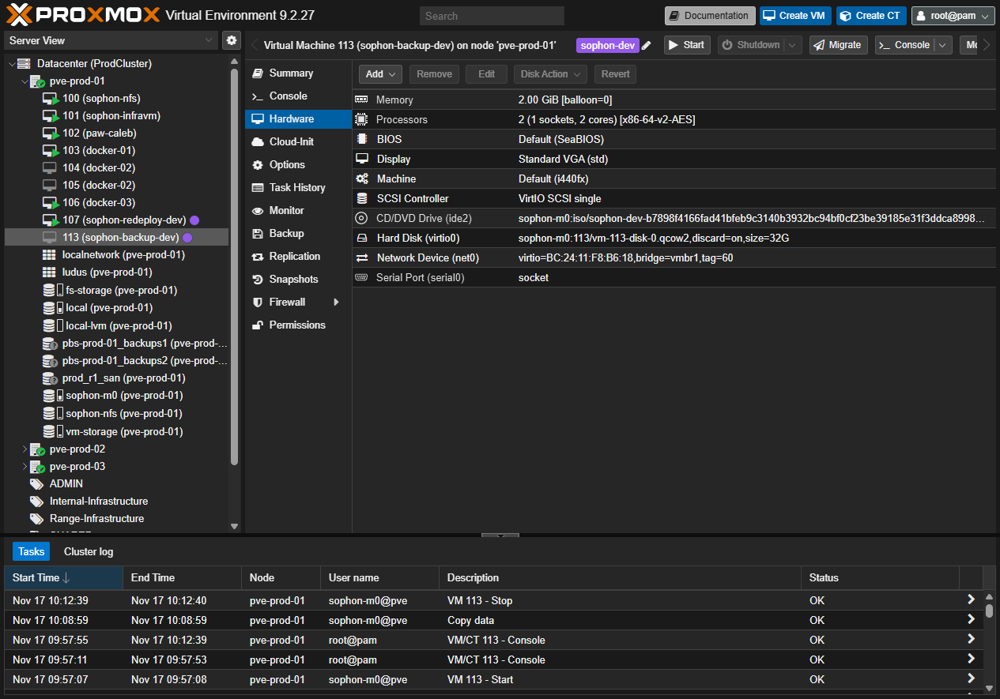
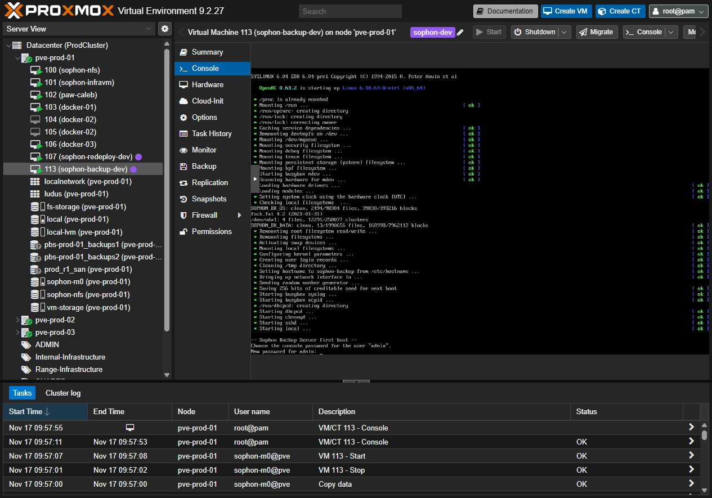
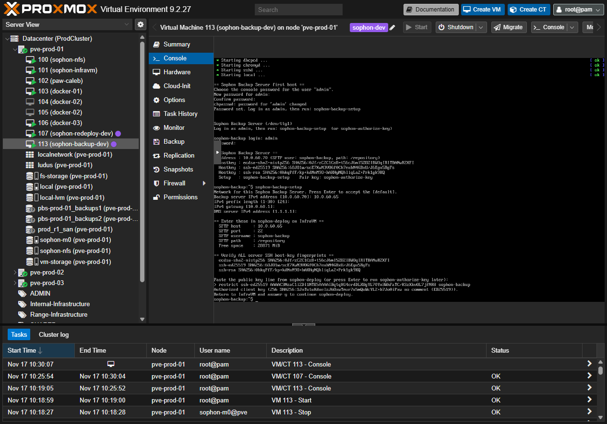

# Sophon Installation, Operations & Disaster Recovery Guide

This walkthrough shows every human-facing step required—starting from the workstation CLI commands that build media and provision VMs—to stand up a clean SFTP backup target, deploy Sophon onto a blank virtual machine (either **zero-prompt unattended** via optional mode-`0600` secrets ISOs or **interactively** on the VM console), verify Day-1 SSO and container management in **Arcane**, run zero-downtime backups, recover full application state (`sophon-restore` + `sophon-activate`), and execute hypervisor-agnostic restore drills (`verify-restore`) across Proxmox, VMware vCenter, and Microsoft Hyper-V.

---

## 1. Architecture & Operating Principles

Sophon runs on a single **Fedora CoreOS** virtual machine (**InfraVM**) with a dual-partition persistent layout:

- **Partition 4 (`root`, `8 GiB` XFS):** Immutable OSTree operating system root.
- **Partition 5 (`sophon-var`, remaining disk, Btrfs):** Persistent `/var` mounted with `noatime,user_subvol_rm_allowed`. During first-boot host setup, `/var/home/core/.local/share/containers/storage/volumes` is created as a dedicated **Btrfs subvolume** (`inode=256`).
- **Declarative Compose stacks (`/var/lib/sophon/stacks/<stack>/compose.yaml`):** Deployed directly over the rootless Podman socket without routing deployment through any web UI.
- **Arcane (`https://arcane.<domain>`):** Open-source container management UI authenticated via Keycloak OIDC (`arcane-admins` LDAP group maps to `role_admin`).
- **Two-tier encrypted Kopia backups over confined SFTP:**
  1. **Primary backups (`backup@sophon:/sophon-state`, default every `6h`):** Captures only irreproducible application state (user repositories, generated application identity keys, ACME certificates) and native database logical exports (`pg_dumpall`, `slapcat`).
  2. **Optional weekly live volume snapshots (`backup@sophon:/sophon-coarse`, latest 4 kept):** Creates an atomic, read-only Btrfs subvolume snapshot (`BTRFS_IOC_SNAP_CREATE_V2`) of the Podman `volumes` subvolume with **zero container stops**, uploads to SFTP, and destroys the local snapshot. Last-resort use only.

> **Golden rule:** Sophon is infrastructure as code. Nothing may exist only in the Arcane UI. Rebuilding a lost server is always **"rerun `sophon-deploy` on a clean VM, then restore application state with `sophon-restore`"**, never restoring a full-disk VM image.

---

## 2. Deploy the Sophon SFTP Backup Appliance (or Use an Existing SFTP Host)

Sophon stores encrypted Kopia snapshots on an external confined SFTP server—ideally on a separate physical host, NAS, or storage pool from InfraVM so backups survive storage or hypervisor loss. You never need to generate SSH client keys or `known_hosts` files by hand: InfraVM generates its own `ed25519` client identity and scans the server's host keys interactively.

`bash sophon-provision.sh prepare` (automatically invoked by `sophon-provision.sh`) builds a turnkey, offline, hybrid BIOS + UEFI **Alpine 3.24 SFTP Backup Server ISO** at:

```text
artifacts/backup/sophon-backup-installer.iso
```

*(If you already have an existing NAS or Linux server you prefer to use, expand **Section 2.3** below instead.)*

### 2.0 Unattended Backup + InfraVM Preconfiguration (Optional, Hypervisor-Agnostic)

If you want **zero interactive VM console prompts** on either the Alpine Backup Server or CoreOS InfraVM—with pre-paired SSH host and client keys (`sophon-backup` + read-only `sophon-restore`) and a **single InfraVM secrets ISO that works for both Day-1 builds and automated restores**—generate the optional mode-`0600` secrets ISOs on your workstation before provisioning:

```bash
# 1. Build immutable OS, deployment, and backup appliance ISOs
bash sophon-provision.sh prepare

# 2. (Air-gapped sites only) Pre-issue wildcard TLS certificate store
bash sophon-provision.sh certificates issue --domain <your-domain>

# 3. Generate mode-0600 secrets ISOs (`sophon-secrets.iso` + `sophon-backup-secrets.iso`)
bash sophon-provision.sh secrets --with-backup

# 4. Provision the SFTP Backup Server VM on Proxmox, vCenter, or Hyper-V
bash sophon-provision.sh provision-backup
```

When `artifacts/secrets/sophon-backup-secrets.iso` (`SOPHON_BACKUP_CERTS`) is attached, `sophon-backup-autoseed` runs automatically on the Backup Server's first boot: it sets the `admin` console password hash, configures static IPv4 networking, installs the pre-paired Ed25519 SSH host key and confined `sophon-backup` / `sophon-restore` public keys, reloads `sshd`, and ejects the secrets CD-ROM—skipping Sections 2.1–2.2 completely. If `sophon-backup-secrets.iso` is **not** attached, the appliance falls back 100% to the interactive setup in Sections 2.1–2.2.

### 2.1 Manual / Interactive Option: Boot a blank VM with `sophon-backup-installer.iso`

The backup appliance uses the exact same console-first, blank-disk workflow as InfraVM—no Cloud-Init drive, no SSH from your laptop, and identical behavior on Proxmox, vCenter, and Hyper-V:

1. Upload `artifacts/backup/sophon-backup-installer.iso` (`~133 MiB`) to your hypervisor.
2. Create a blank 64-bit Linux VM (`1–2` vCPU, `1–2 GiB` RAM, **one** blank disk of `16+ GiB`—for example `32 GiB` for dev or `200+ GiB` for production with `discard=on`, and one NIC on your backup network/VLAN). Adding `Serial Port (serial0)` in Proxmox also enables browser copy/paste via `xterm.js`.
3. Attach `sophon-backup-installer.iso` as a CD/DVD drive and set **boot order to the blank disk first, then the CD/DVD drive**.



4. Click **Start** and open the VM's console. Because the disk is blank, the VM boots `sophon-backup-installer.iso`, partitions the disk (`EFI` + `1.5 GiB` Alpine OS + all remaining space mounted at `/var/lib/sophon-backups`), generates persistent SSH host keys, configures the jailed `sophon-backup` `internal-sftp` chroot (`/var/lib/sophon-backups/repository`), and reboots into the installed appliance in ~20 seconds:



*(Once installed, you can detach `sophon-backup-installer.iso`; even if left attached, the installer refuses to touch any non-blank disk.)*

### 2.2 First-boot password & `sophon-backup-setup`

1. At `== Sophon Backup Server first boot ==`, choose and confirm a console password for `admin`, then log in as `admin`.
2. Upon login, the banner displays the current DHCP IPv4 address and all three `SHA256` SSH host-key fingerprints.
3. Run `sophon-backup-setup` (do **not** use `sudo` or `doas`). Press `Enter` to accept the detected network defaults or enter your desired static IPv4 address, prefix, gateway, and DNS resolver:


`sophon-backup-setup` applies the static IP immediately and prints the exact values you will enter into `sophon-deploy` on InfraVM (`SFTP host`, `SFTP port: 22`, `SFTP username: sophon-backup`, `SFTP path: /repository`, free MiB, and all `SHA256` host-key fingerprints). Leave that prompt open at `Paste the public key line from sophon-deploy` (or press `Enter` and run `sophon-authorize-key` once InfraVM reaches Step 4.3).

### 2.3 Optional: Using an existing Linux server or NAS instead

<details>
<summary>Click to expand manual OpenSSH internal-sftp chroot commands for Debian/Ubuntu/RHEL</summary>

If you are pointing Sophon at an existing Linux server instead of deploying `sophon-backup-installer.iso`, run:

```bash
sudo useradd --system --user-group --no-create-home \
    --home-dir /repository --shell /usr/sbin/nologin sophon-backup
sudo usermod -p '*' sophon-backup
sudo useradd --system --non-unique \
    --uid "$(id -u sophon-backup)" --gid "$(id -g sophon-backup)" \
    --no-create-home --home-dir /repository --shell /usr/sbin/nologin sophon-restore
sudo usermod -p '*' sophon-restore
sudo install -d -o root -g root -m 0755 /var/lib/sophon-backups /etc/ssh/authorized_keys
sudo install -d -o sophon-backup -g sophon-backup -m 0700 /var/lib/sophon-backups/repository
sudo install -o root -g root -m 0644 /dev/null /etc/ssh/authorized_keys/sophon-backup
sudo install -o root -g root -m 0644 /dev/null /etc/ssh/authorized_keys/sophon-restore

sudo tee /etc/ssh/sshd_config.d/50-sophon-backup.conf >/dev/null <<'EOF'
Match User sophon-backup
    AuthorizedKeysFile /etc/ssh/authorized_keys/sophon-backup
    ChrootDirectory /var/lib/sophon-backups
    ForceCommand internal-sftp
    PasswordAuthentication no
    KbdInteractiveAuthentication no
    AllowTcpForwarding no
    X11Forwarding no
    PermitTunnel no
    PermitTTY no
Match User sophon-restore
    AuthorizedKeysFile /etc/ssh/authorized_keys/sophon-restore
    ChrootDirectory /var/lib/sophon-backups
    ForceCommand internal-sftp -R
    PasswordAuthentication no
    KbdInteractiveAuthentication no
    AllowTcpForwarding no
    X11Forwarding no
    PermitTunnel no
    PermitTTY no
Match all
EOF
sudo chmod 0644 /etc/ssh/sshd_config.d/50-sophon-backup.conf
sudo sshd -t && sudo systemctl reload ssh
for pub in /etc/ssh/ssh_host_*_key.pub; do sudo ssh-keygen -lf "$pub"; done
```

When `sophon-deploy` displays its generated `restrict ssh-ed25519 ...` line in Section 4.3, write it to `/etc/ssh/authorized_keys/sophon-backup` (`root:root`, mode `0644`); for read-only standby or weekly `verify-restore` drills (Section 7.4), write the dedicated restore public key to `/etc/ssh/authorized_keys/sophon-restore`.
</details>

---

## 3. Build Media & Boot InfraVM

On your workstation (with Docker or Podman installed), run:

```bash
bash sophon-provision.sh          # Windows PowerShell: .\sophon-provision.ps1
```

When `artifacts/secrets/sophon-secrets.iso` (or `sophon-certificates.iso` for interactive air-gapped sites) exists locally, `provision` automatically uploads and attaches it as a third CD/DVD drive (`SOPHON_CERTS`) on **Proxmox, VMware vCenter, and Microsoft Hyper-V**.

If you generated `sophon-secrets.iso` in Section 2.0, **nothing needs to be typed on the InfraVM console**:
1. CoreOS installs itself to the blank disk and reboots.
2. On first boot before `getty`, `sophon-seed-early.service` copies `/sophon-seed.json` (and optional `acme.json`) into root-only RAM (`tmpfs` `/run/sophon-seed`), unmounts and ejects the secrets CD-ROM, sets the `core` console password hash, and marks first-boot password setup complete.
3. `sophon-autodeploy.service` configures static IPv4 networking, waits for host bootstrap, deletes the temporary seed file as soon as `console.py --auto` reads it into memory, and inspects the SFTP Kopia repository:
   - **Empty `/repository` → Day-1 Build:** Initializes the encrypted Kopia repository, deploys all seven stacks (plus `cloudflared` when enabled), runs and verifies the initial backup, enables the `6h` schedule, verifies all containers and SNI TLS endpoints locally, and sets the console login banner (`/etc/issue`) to `DAY-1 DEPLOYMENT COMPLETE (ACTIVE PRODUCTION)`. Skip directly to **Section 5**.
   - **Existing snapshots in `/repository` → Safe Standby Auto-Restore:** Postpones `cloudflared` (never touches public Cloudflare DNS/tunnels), connects Kopia `--readonly` with scheduled backups disabled, deploys the stacks, runs `sophon-restore --snapshot latest --yes`, verifies all containers and SNI TLS endpoints locally, and sets `/etc/issue` to `STANDBY RESTORE COMPLETE`. (Promote to live production only when desired by logging in as `core` and running `sophon-activate`; see **Section 7**.)

If `sophon-secrets.iso` is **not** attached, InfraVM boots cleanly into the interactive workflow below.

If you are creating the VM manually on Proxmox, vCenter, Hyper-V, or Workstation after running `bash sophon-provision.sh prepare`:

1. Upload `artifacts/coreos/sophon-installer.iso` and `artifacts/bootstrap/sophon-deployment.iso` (plus optional `artifacts/secrets/sophon-secrets.iso` or `artifacts/secrets/sophon-certificates.iso`).
2. Create a blank 64-bit Linux VM (`4+` vCPU, `8 GiB` RAM, one blank `40+ GiB` disk—`64 GiB` recommended with `discard=on`, and one NIC on your target VLAN/network).
3. Attach the ISOs as CD/DVD drives and set **boot order to the blank disk first, then the installer ISO**.


Power on the VM and open its console. Because the disk starts blank, firmware falls through to `sophon-installer.iso`. `sophon-autoinstall` automatically mounts `SOPHON_DEPLOY`, writes Fedora CoreOS to disk, resizes `root` to `8 GiB`, formats the remaining space as Btrfs (`sophon-var`), copies the offline Sophon bundle into `/var/lib/sophon`, and reboots into the installed OS—no typing required:


---

## 4. First Boot & Interactive `sophon-deploy`

### 4.1 Set the console password for `core`

On first boot, `sophon-set-password.service` locks console login until you choose a local password for `core`:


Enter and confirm the password, then log in at the prompt as `core`.

### 4.2 Configure static networking

Run `sophon-deploy` (do **not** use `sudo`). On its first run, `sophon-network` detects the current DHCP lease and offers its IPv4 address, prefix length, and gateway as defaults alongside `1.1.1.1` for upstream DNS:


> **Important:** Always use a real upstream DNS resolver (your upstream router/firewall or `1.1.1.1`), never a workstation or Hyper-V Default Switch IP that forwards DNS back to InfraVM.

After applying the static address, `sophon-deploy` finishes host bootstrap (`sophon-host-bootstrap.service`), creating the Btrfs `volumes` subvolume and loading the offline `sophon:latest` runner image.

### 4.3 Service settings, SFTP pairing & preflight

`sophon-deploy` then prompts for site settings (each secret input echoes `*` and is never persisted to disk):

1. **Internet access (`[Y/n]`):** Keep **Y** for connected sites (Let's Encrypt DNS-01 + optional Cloudflare tunnel), or answer **n** for air-gapped/offline sites using a pre-issued `acme.json` (`SOPHON_CERTS` disk). On connected sites, `SOPHON_CF_TUNNEL_ENABLED` defaults to `true`; enter `false` if you want Let's Encrypt DNS-01 certificates on a LAN/dev/standby VM without creating a Cloudflare tunnel or repointing public DNS CNAMEs.
2. **Shared service password (`[y/N]`):** Answer **y** if you want to enter one `12+` character password once for local admin/database accounts, or **n** to enter separate passwords per service. Note that the **Kopia repository encryption password** is always entered separately—store it in your password manager, as backups cannot be decrypted without it.
3. **Backup target (`SOPHON_KOPIA_SFTP_*`):** Enter your SFTP server IP/hostname, port (`22`), username (`sophon-backup`), and chroot-relative path (`/repository`). `SOPHON_KOPIA_BACKUPS_ENABLED` defaults to `true`: `sophon-deploy` automatically runs and verifies the initial snapshot at the end of deployment and starts the 6-hour schedule in a single pass (no second rerun needed). Optionally set `SOPHON_KOPIA_COARSE_ENABLED=true` if you also want weekly zero-downtime Btrfs volume snapshots.

Before deploying any container stack, `sophon-deploy` generates `/var/lib/sophon/project/credentials/kopia/id_ed25519` (`0600`), prints a ready-to-paste `authorized_keys` line, and scans the SFTP server's SSH host keys:


1. Compare **all** displayed `SHA256:...` fingerprints against Section 2.2's output on the Sophon Backup Server console.
2. Switch to the Sophon Backup Server console and paste the displayed `restrict ssh-ed25519 ...` line into the waiting `sophon-backup-setup` prompt (or run `sophon-authorize-key` and paste it there). *(Tip: in Proxmox, opening `>_ Console -> xterm.js` via `serial0` allows direct clipboard copy/paste.)*



3. Return to the InfraVM console, type `y` to confirm the verified `SHA256` host-key fingerprints, and type `y` at `Install the displayed public key on the server, then continue? [y/N]`.
4. Sophon immediately verifies SFTP authentication, read/write/delete integrity, and free space (`statvfs@openssh.com`), checks whether a Kopia repository already exists at `/repository`, and—only when the path is empty—asks before creating a new encrypted repository:


Confirm with `y`. Ansible (`4-configure.yml`) then reconciles all core Compose projects (`coredns`, `traefik`, `openldap`, `keycloak`, `gitea`, `arcane`, and `kopia`) and waits for health checks to pass. Once `sophon-deploy` finishes, detach the installer and deployment ISOs from InfraVM.

---

## 5. Day-1 Verification & Web UI Tour

Point your client machine's DNS for your Sophon domain at InfraVM's IPv4 address (see [split-horizon DNS instructions](../README.md#using-the-services)), then open `https://arcane.<domain>`:


Click **Keycloak** to authenticate through Sophon's central SSO (`https://auth.<domain>`):


Signing in as an LDAP member of `arcane-admins` (for example the seeded `john.doe.admin` account) grants global `role_admin` access in Arcane automatically. Open **Deploy -> Projects** (`https://arcane.<domain>/projects`) to inspect all seven Compose projects discovered from `/var/lib/sophon/stacks`:


> **Note on `Partially running` status:** Stacks such as `gitea` and `traefik` include one-shot initialization containers (`gitea-init`, `traefik-init`) that seed configuration and exit `0`. Arcane accurately reports those stacks as `Partially running` while all long-running service containers remain healthy.

Next, verify Git hosting at `https://git.<domain>` (using **Sign In With Keycloak** or the `siteadmin` account):


---

## 6. Kopia Web UI, On-Demand Backups & Live Btrfs Snapshots

### 6.1 Browse snapshots & download individual files in the Kopia Web UI

When `sophon-deploy` finishes with `SOPHON_KOPIA_BACKUPS_ENABLED=true` (the default), Sophon has already executed and verified your first primary backup and enabled the automatic `6h` schedule.

To browse snapshot history or download individual files from a browser, open `https://kopia.<domain>` and sign in with your Kopia UI username (`admin`) and password. Switch the filter button at the top left from **Local Snapshots** to **All Snapshots** to view `/sophon-state` (primary 6-hour backups) and, if enabled, `/sophon-coarse` (weekly live Btrfs volume snapshots):


Click `/sophon-state` and select any snapshot timestamp to inspect its directory tree or download individual files directly:


> **What to do in the Kopia Web UI vs. the CLI:**
> - **Use the Kopia Web UI** for inspecting snapshot history, checking sizes/retention, downloading individual files (for example grabbing one file out of `gitea/` or inspecting `manifest.json`), and even clicking **Snapshot Now** on `/sophon-state`—because Sophon configures `/app/backup.py` as Kopia's native `before-snapshot-root` and `after-snapshot-root` actions (`--action-command-mode=essential`), UI-triggered and scheduled snapshots automatically run hot database dumps, stage volume reflinks, apply `.kopiaignore` exclusions, and clean up staging!
> - **Do not use the Kopia Web UI's "Restore" button to restore live containers**, and do not edit repository policy settings in the UI (Sophon reconciles policy from code). Kopia mounts `/volumes:ro` read-only and does not replay `pg_restore`/`psql`/`slapadd` or merge generated secrets into `app.ini`—always use `sophon-restore` on the InfraVM CLI for container recovery.

### 6.2 Trigger an on-demand backup or inspect Btrfs snapshot status

From the InfraVM console (logged in as `core`), you can trigger an extra primary backup or inspect the latest run report at any time:

```bash
podman exec kopia python3 /app/backup.py run
podman exec kopia cat /source/last-run.json
```

If you enabled weekly zero-downtime read-only Btrfs subvolume snapshots (`SOPHON_KOPIA_COARSE_ENABLED=true`), you can inspect `/var` mount options and the latest weekly snapshot status with:

```bash
findmnt /var
cat /var/home/core/sophon-coarse/last-run.json
```

---

## 7. Disaster Recovery, Production Promotion (`sophon-activate`) & Automated Restore Drills

If InfraVM or its virtual disk is completely lost, Sophon rebuilds from code and restores application state from the encrypted SFTP Kopia repository.

### 7.1 Unattended Recovery + `sophon-activate` (Using `sophon-secrets.iso`)

Because `sophon-secrets.iso` unifies Day-1 builds and restores:

1. Reprovision a clean VM with the same `sophon-secrets.iso` on Proxmox, vCenter, or Hyper-V:
   ```bash
   SOPHON_ALLOW_PRODUCTION_DESTROY=true SOPHON_DESTROY_VM_NAME=sophon-infravm \
     bash sophon-provision.sh destroy-vm
   bash sophon-provision.sh provision
   ```
2. On first boot, `sophon-autodeploy` detects the existing snapshots in `/repository` and automatically brings the server up in **Safe Standby Mode** (`cloudflared` postponed so live DNS is never hijacked prematurely, Kopia `--readonly`, scheduled backups paused), runs `sophon-restore --snapshot latest --yes` across `traefik`, `ldap`, `keycloak`, and `gitea`, and verifies all 7 containers + HTTPS SNI endpoints locally inside the guest (`STANDBY RESTORE COMPLETE` on `/etc/issue`).
3. Verify your restored services at `https://arcane.<domain>` and `https://git.<domain>`.
4. **Only when you are ready to promote this server into live production**, log in to the InfraVM console as `core` and run:
   ```bash
   sophon-activate
   ```
   `sophon-activate` verifies read-write `sophon-backup` SFTP access, enables `cloudflared` tunnel publishing if configured (`--enable-tunnel` / `--disable-tunnel` overrides available), switches Kopia from `--readonly` to active scheduled backups, runs an immediate verified snapshot, and updates `/etc/issue` to `ACTIVE PRODUCTION`. *(Standby/dev drill VMs simply skip `sophon-activate` and remain permanently non-disruptive.)*

### 7.2 Interactive Console Recovery (`sophon-deploy` + `sophon-restore`)

When recovering **without** a secrets ISO:

1. Provision a new blank VM with `sophon-installer.iso` and `sophon-deployment.iso` (Section 3) and complete first-boot password and network setup (Sections 4.1–4.2).
2. Run `sophon-deploy` using the same domain, realm, and SFTP repository settings (`SOPHON_KOPIA_PASSWORD`, `SOPHON_KOPIA_SFTP_HOST`, `SOPHON_KOPIA_SFTP_USERNAME`, `SOPHON_KOPIA_SFTP_PATH`).
   - **Full cutover recovery (replacing a lost production server):** Run `sophon-deploy` with `SOPHON_KOPIA_SFTP_USERNAME=sophon-backup` (and `SOPHON_CF_TUNNEL_ENABLED=true` if production publishes a Cloudflare tunnel). Answer **n** when asked whether to start scheduled backups immediately before restoring.
   - **Non-destructive standby / test restore alongside live production:** Run `sophon-deploy --prepare-restore` with `SOPHON_KOPIA_SFTP_USERNAME=sophon-restore` (and authorize the generated key via `sophon-authorize-key --readonly`). `--prepare-restore` forces `SOPHON_CF_TUNNEL_ENABLED=false`, skips Cloudflare tunnel/DNS mutations, seeds a temporary pre-restore certificate until `sophon-restore` restores `acme.json`, and connects Kopia in strict `--readonly` mode with scheduled backups paused.
3. Authorize InfraVM's newly generated `ed25519` public key on the Sophon Backup Server (`sophon-authorize-key` or `sophon-authorize-key --readonly`) and confirm the server's `SHA256:...` host-key fingerprints.
4. Log in to the rebuilt InfraVM console as `core` (never with `sudo`) and run:

```bash
sophon-restore
```

`sophon-restore` inspects the latest snapshot, lists the four stateful services (`traefik`, `ldap`, `keycloak`, `gitea`), asks once for confirmation (`[y/N]`), and automatically restores all of them in order—pausing each service briefly, restoring files via Btrfs CoW reflinks with numeric ownership preserved, replaying PostgreSQL/OpenLDAP dumps, restarting the containers, and cleaning up temporary staging:


*(Need to roll back only one service or use a specific older snapshot? Run `sophon-restore --group gitea` or `sophon-restore --snapshot <SNAPSHOT_ID>`.)*

### 7.3 Verify & Activate After Interactive Recovery

1. Sign in to `https://arcane.<domain>` and `https://git.<domain>` via Keycloak SSO and verify your LDAP users, Keycloak clients, TLS certificates, and Git repositories/commit history match pre-loss state.
2. If you deployed with `--prepare-restore` (using `sophon-backup`) or paused scheduled backups, run `sophon-activate` (or rerun `sophon-deploy` with `SOPHON_KOPIA_BACKUPS_ENABLED=true`) to enable live backups and optional Cloudflare tunnel publishing.

### 7.4 Hypervisor-Agnostic Automated Weekly Restore Drills (`verify-restore`)

`verify-restore` works identically across **Proxmox, VMware vCenter, and Microsoft Hyper-V**—with **no Proxmox `serial0` dependency** and **no requirement that the automation workstation can reach the destination VM's VLAN over HTTPS**:

1. **One-time drill secrets ISO (`sophon-dev-secrets.iso`):**
   Generate a dedicated drill secrets ISO that uses a separate dev/drill static IP (or DHCP) and the confined read-only `sophon-restore` SFTP key (`internal-sftp -R`, already pre-paired if your Backup Server was seeded with `secrets --with-backup`, or authorized once via `sophon-authorize-key --readonly`):
   ```bash
   SOPHON_NETWORK_CIDR=10.0.60.107/24 \
   bash sophon-provision.sh secrets \
     --readonly-sftp \
     --output-iso artifacts/secrets/sophon-dev-secrets.iso
   ```
   *(Because `sophon-restore` is enforced as `internal-sftp -R` by OpenSSH on the Backup Server and `sophon-autodeploy` runs in Safe Standby Mode without `sophon-activate`, the drill VM can never repoint Cloudflare DNS/tunnels, write to `/repository`, or overwrite production's `sophon-backup` key.)*

2. **Populate `~/.config/sophon/verify-restore.env` (`chmod 600`):**
   Include your hypervisor connection variables (`SOPHON_HYPERVISOR=proxmox|vcenter|hyperv` + credentials) and optional drill overrides:
   ```ini
   SOPHON_INFRAVM_NAME=sophon-dev-infravm
   SOPHON_SECRETS_ISO=/home/<you>/sophon/artifacts/secrets/sophon-dev-secrets.iso
   ```

3. **Run an unattended restore drill on demand or on a weekly schedule:**
   ```bash
   bash sophon-provision.sh verify-restore
   ```
   `verify-restore` validates `/sophon-seed.json` inside `sophon-dev-secrets.iso`, refuses production VM names (`sophon-infravm`, `sophon-backup`), destroys any prior `sophon-dev-infravm` instance (`3-destroy-vm.yml`), and provisions a fresh `sophon-dev-infravm` with `sophon-installer.iso`, `sophon-deployment.iso`, and `sophon-dev-secrets.iso`. Inside the guest, `sophon-autodeploy` installs CoreOS, restores the latest snapshot in Safe Standby Mode, verifies all 7 containers + SNI HTTPS endpoints locally, and writes the result to `/etc/issue` and `/var/lib/sophon/autodeploy-status.json`. *(If your workstation happens to be on the same LAN as the drill VM and you also want the workstation CLI to block until HTTPS responds, append `--wait-https`.)*

   To run automatically every week from a Linux workstation (catching up on wake if asleep):
   ```bash
   mkdir -p ~/.config/systemd/user
   cp contrib/systemd/sophon-verify-restore.{service,timer} ~/.config/systemd/user/
   systemctl --user daemon-reload
   systemctl --user enable --now sophon-verify-restore.timer
   ```

