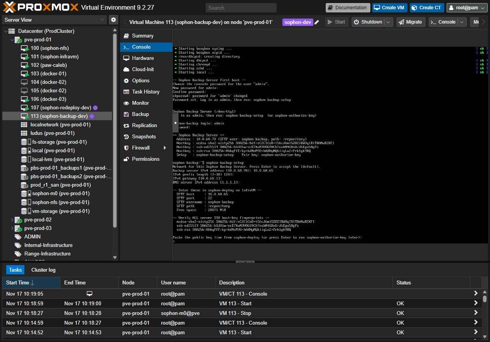
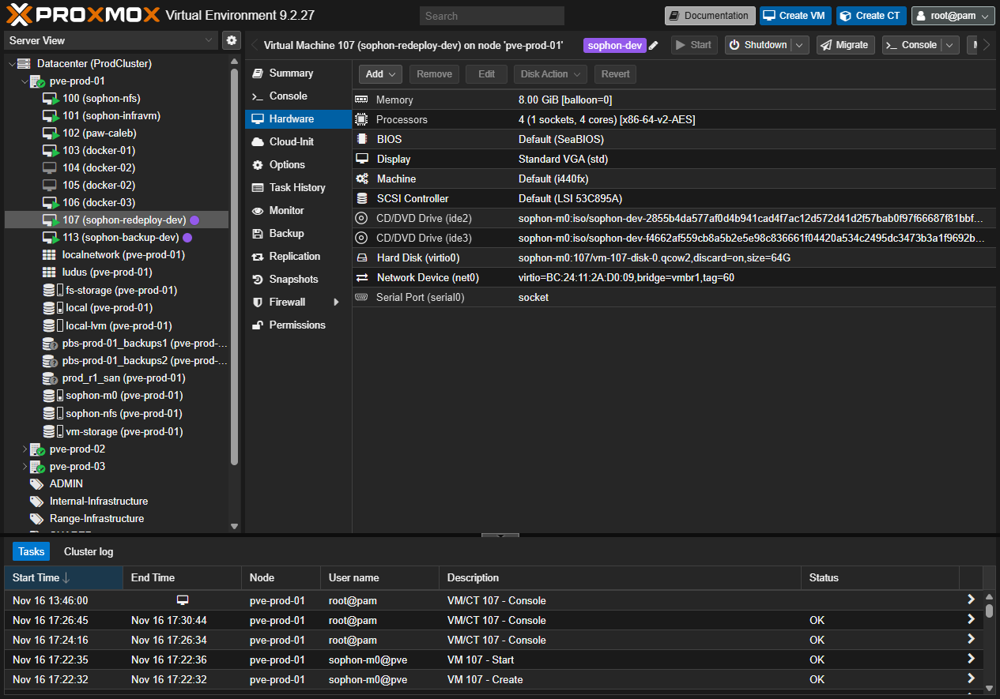
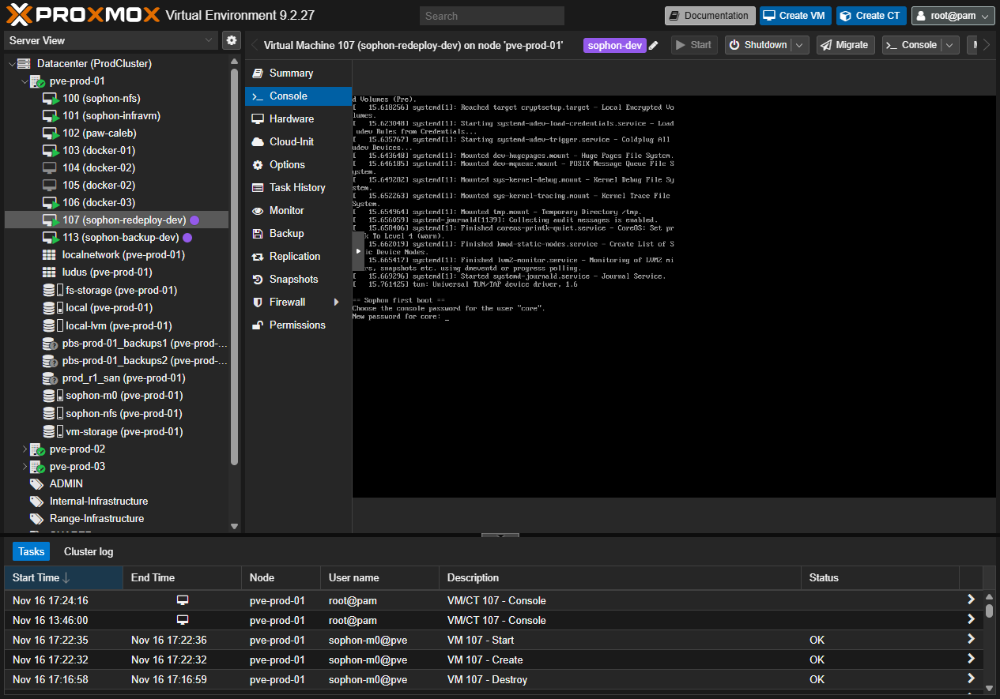

# Sophon Installation, Operations & Disaster Recovery Guide

This walkthrough shows every human-facing step required to stand up a clean SFTP backup target, install Sophon onto a blank virtual machine, complete interactive console configuration (`sophon-deploy`), verify Day-1 SSO and container management in **Arcane**, enable zero-downtime backups, and recover full application state onto a freshly wiped VM (`sophon-restore`).

---

## 1. Architecture & Operating Principles

Sophon runs on a single **Fedora CoreOS** virtual machine (**InfraVM**) with a dual-partition persistent layout:

- **Partition 4 (`root`, `8 GiB` XFS):** Immutable OSTree operating system root.
- **Partition 5 (`sophon-var`, remaining disk, Btrfs):** Persistent `/var` mounted with `noatime,user_subvol_rm_allowed`. During first-boot host setup, `/var/home/core/.local/share/containers/storage/volumes` is created as a dedicated **Btrfs subvolume** (`inode=256`).
- **Declarative Compose stacks (`/var/lib/sophon/stacks/<stack>/compose.yaml`):** Deployed directly over the rootless Podman socket without routing deployment through any web UI.
- **Arcane (`https://arcane.<domain>`):** Open-source container management UI authenticated via Keycloak OIDC (`arcane-admins` LDAP group maps to `role_admin`).
- **Two-tier encrypted Kopia backups over confined SFTP:**
  1. **Primary backups (`backup@sophon:/sophon-state`, default every `6h`):** Captures only irreproducible application state (user repositories, generated application identity keys, ACME certificates) and native database logical exports (`pg_dumpall`, `slapcat`).
  2. **Optional weekly live volume snapshots (`backup@sophon:/sophon-coarse`, latest 4 kept):** Creates an atomic, read-only Btrfs subvolume snapshot (`BTRFS_IOC_SNAP_CREATE_V2`) of the Podman `volumes` subvolume with **zero container stops**, uploads to SFTP, and destroys the local snapshot. Last-resort use only.

> **Golden rule:** Sophon is infrastructure as code. Nothing may exist only in the Arcane UI. Rebuilding a lost server is always **"rerun `sophon-deploy` on a clean VM, then restore application state with `sophon-restore`"**, never restoring a full-disk VM image.

---

## 2. Deploy the Sophon SFTP Backup Appliance (or Use an Existing SFTP Host)

Sophon stores encrypted Kopia snapshots on an external confined SFTP server—ideally on a separate physical host, NAS, or storage pool from InfraVM so backups survive storage or hypervisor loss. You never need to generate SSH client keys or `known_hosts` files by hand: InfraVM generates its own `ed25519` client identity and scans the server's host keys interactively.

`bash sophon-provision.sh prepare` (automatically invoked by `sophon-provision.sh`) builds a turnkey, offline, hybrid BIOS + UEFI **Alpine 3.24 SFTP Backup Server ISO** at:

```text
artifacts/backup/sophon-backup-installer.iso
```

*(If you already have an existing NAS or Linux server you prefer to use, expand **Section 2.3** below instead.)*

### 2.1 Boot a blank VM with `sophon-backup-installer.iso`

The backup appliance uses the exact same console-first, blank-disk workflow as InfraVM—no Cloud-Init drive, no SSH from your laptop, and identical behavior on Proxmox, vCenter, and Hyper-V:

1. Upload `artifacts/backup/sophon-backup-installer.iso` (`~133 MiB`) to your hypervisor.
2. Create a blank 64-bit Linux VM (`1–2` vCPU, `1–2 GiB` RAM, **one** blank disk of `16+ GiB`—for example `32 GiB` for dev or `200+ GiB` for production with `discard=on`, and one NIC on your backup network/VLAN). Adding `Serial Port (serial0)` in Proxmox also enables browser copy/paste via `xterm.js`.
3. Attach `sophon-backup-installer.iso` as a CD/DVD drive and set **boot order to the blank disk first, then the CD/DVD drive**.


4. Click **Start** and open the VM's console. Because the disk is blank, the VM boots `sophon-backup-installer.iso`, partitions the disk (`EFI` + `1.5 GiB` Alpine OS + all remaining space mounted at `/var/lib/sophon-backups`), generates persistent SSH host keys, configures the jailed `sophon-backup` `internal-sftp` chroot (`/var/lib/sophon-backups/repository`), and reboots into the installed appliance in ~20 seconds:


*(Once installed, you can detach `sophon-backup-installer.iso`; even if left attached, the installer refuses to touch any non-blank disk.)*

### 2.2 First-boot password & `sophon-backup-setup`

1. At `== Sophon Backup Server first boot ==`, choose and confirm a console password for `admin`, then log in as `admin`.
2. Upon login, the banner displays the current DHCP IPv4 address and all three `SHA256` SSH host-key fingerprints.
3. Run `sophon-backup-setup` (do **not** use `sudo` or `doas`). Press `Enter` to accept the detected network defaults or enter your desired static IPv4 address, prefix, gateway, and DNS resolver:



`sophon-backup-setup` applies the static IP immediately and prints the exact values you will enter into `sophon-deploy` on InfraVM (`SFTP host`, `SFTP port: 22`, `SFTP username: sophon-backup`, `SFTP path: /repository`, free MiB, and all `SHA256` host-key fingerprints). Leave that prompt open at `Paste the public key line from sophon-deploy` (or press `Enter` and run `sophon-authorize-key` once InfraVM reaches Step 4.3).

### 2.3 Optional: Using an existing Linux server or NAS instead

<details>
<summary>Click to expand manual OpenSSH internal-sftp chroot commands for Debian/Ubuntu/RHEL</summary>

If you are pointing Sophon at an existing Linux server instead of deploying `sophon-backup-installer.iso`, run:

```bash
sudo useradd --system --user-group --no-create-home \
    --home-dir /repository --shell /usr/sbin/nologin sophon-backup
sudo usermod -p '*' sophon-backup
sudo useradd --system --non-unique \
    --uid "$(id -u sophon-backup)" --gid "$(id -g sophon-backup)" \
    --no-create-home --home-dir /repository --shell /usr/sbin/nologin sophon-restore
sudo usermod -p '*' sophon-restore
sudo install -d -o root -g root -m 0755 /var/lib/sophon-backups /etc/ssh/authorized_keys
sudo install -d -o sophon-backup -g sophon-backup -m 0700 /var/lib/sophon-backups/repository
sudo install -o root -g root -m 0644 /dev/null /etc/ssh/authorized_keys/sophon-backup
sudo install -o root -g root -m 0644 /dev/null /etc/ssh/authorized_keys/sophon-restore

sudo tee /etc/ssh/sshd_config.d/50-sophon-backup.conf >/dev/null <<'EOF'
Match User sophon-backup
    AuthorizedKeysFile /etc/ssh/authorized_keys/sophon-backup
    ChrootDirectory /var/lib/sophon-backups
    ForceCommand internal-sftp
    PasswordAuthentication no
    KbdInteractiveAuthentication no
    AllowTcpForwarding no
    X11Forwarding no
    PermitTunnel no
    PermitTTY no
Match User sophon-restore
    AuthorizedKeysFile /etc/ssh/authorized_keys/sophon-restore
    ChrootDirectory /var/lib/sophon-backups
    ForceCommand internal-sftp -R
    PasswordAuthentication no
    KbdInteractiveAuthentication no
    AllowTcpForwarding no
    X11Forwarding no
    PermitTunnel no
    PermitTTY no
Match all
EOF
sudo chmod 0644 /etc/ssh/sshd_config.d/50-sophon-backup.conf
sudo sshd -t && sudo systemctl reload ssh
for pub in /etc/ssh/ssh_host_*_key.pub; do sudo ssh-keygen -lf "$pub"; done
```

When `sophon-deploy` displays its generated `restrict ssh-ed25519 ...` line in Section 4.3, write it to `/etc/ssh/authorized_keys/sophon-backup` (`root:root`, mode `0644`); for read-only standby or weekly `verify-restore` drills (Section 7.4), write the dedicated restore public key to `/etc/ssh/authorized_keys/sophon-restore`.
</details>

---

## 3. Build Media & Boot InfraVM

On your workstation (with Docker or Podman installed), run:

```bash
bash sophon-provision.sh          # Windows PowerShell: .\sophon-provision.ps1
```

If you are creating the VM manually on Proxmox, vCenter, Hyper-V, or Workstation after running `bash sophon-provision.sh prepare`:

1. Upload `artifacts/coreos/sophon-installer.iso` and `artifacts/bootstrap/sophon-deployment.iso` (plus `artifacts/secrets/sophon-certificates.iso` for air-gapped sites).
2. Create a blank 64-bit Linux VM (`4+` vCPU, `8 GiB` RAM, one blank `40+ GiB` disk—`64 GiB` recommended with `discard=on`, and one NIC on your target VLAN/network).
3. Attach both ISOs as CD/DVD drives and set **boot order to the blank disk first, then the installer ISO**.



Power on the VM and open its console. Because the disk starts blank, firmware falls through to `sophon-installer.iso`. `sophon-autoinstall` automatically mounts `SOPHON_DEPLOY`, writes Fedora CoreOS to disk, resizes `root` to `8 GiB`, formats the remaining space as Btrfs (`sophon-var`), copies the offline Sophon bundle into `/var/lib/sophon`, and reboots into the installed OS—no typing required:


---

## 4. First Boot & Interactive `sophon-deploy`

### 4.1 Set the console password for `core`

On first boot, `sophon-set-password.service` locks console login until you choose a local password for `core`:



Enter and confirm the password, then log in at the prompt as `core`.

### 4.2 Configure static networking

Run `sophon-deploy` (do **not** use `sudo`). On its first run, `sophon-network` detects the current DHCP lease and offers its IPv4 address, prefix length, and gateway as defaults alongside `1.1.1.1` for upstream DNS:


> **Important:** Always use a real upstream DNS resolver (your upstream router/firewall or `1.1.1.1`), never a workstation or Hyper-V Default Switch IP that forwards DNS back to InfraVM.

After applying the static address, `sophon-deploy` finishes host bootstrap (`sophon-host-bootstrap.service`), creating the Btrfs `volumes` subvolume and loading the offline `sophon:latest` runner image.

### 4.3 Service settings, SFTP pairing & preflight

`sophon-deploy` then prompts for site settings (each secret input echoes `*` and is never persisted to disk):

1. **Internet access (`[Y/n]`):** Keep **Y** for connected sites (Let's Encrypt DNS-01 + optional Cloudflare tunnel), or answer **n** for air-gapped/offline sites using a pre-issued `acme.json` (`SOPHON_CERTS` disk). On connected sites, `SOPHON_CF_TUNNEL_ENABLED` defaults to `true`; enter `false` if you want Let's Encrypt DNS-01 certificates on a LAN/dev/standby VM without creating a Cloudflare tunnel or repointing public DNS CNAMEs.
2. **Shared service password (`[y/N]`):** Answer **y** if you want to enter one `12+` character password once for local admin/database accounts, or **n** to enter separate passwords per service. Note that the **Kopia repository encryption password** is always entered separately—store it in your password manager, as backups cannot be decrypted without it.
3. **Backup target (`SOPHON_KOPIA_SFTP_*`):** Enter your SFTP server IP/hostname, port (`22`), username (`sophon-backup`), and chroot-relative path (`/repository`). `SOPHON_KOPIA_BACKUPS_ENABLED` defaults to `true`: `sophon-deploy` automatically runs and verifies the initial snapshot at the end of deployment and starts the 6-hour schedule in a single pass (no second rerun needed). Optionally set `SOPHON_KOPIA_COARSE_ENABLED=true` if you also want weekly zero-downtime Btrfs volume snapshots.

Before deploying any container stack, `sophon-deploy` generates `/var/lib/sophon/project/credentials/kopia/id_ed25519` (`0600`), prints a ready-to-paste `authorized_keys` line, and scans the SFTP server's SSH host keys:


1. Compare **all** displayed `SHA256:...` fingerprints against Section 2.2's output on the Sophon Backup Server console.
2. Switch to the Sophon Backup Server console and paste the displayed `restrict ssh-ed25519 ...` line into the waiting `sophon-backup-setup` prompt (or run `sophon-authorize-key` and paste it there). *(Tip: in Proxmox, opening `>_ Console -> xterm.js` via `serial0` allows direct clipboard copy/paste.)*


3. Return to the InfraVM console, type `y` to confirm the verified `SHA256` host-key fingerprints, and type `y` at `Install the displayed public key on the server, then continue? [y/N]`.
4. Sophon immediately verifies SFTP authentication, read/write/delete integrity, and free space (`statvfs@openssh.com`), checks whether a Kopia repository already exists at `/repository`, and—only when the path is empty—asks before creating a new encrypted repository:


Confirm with `y`. Ansible (`4-configure.yml`) then reconciles all core Compose projects (`coredns`, `traefik`, `openldap`, `keycloak`, `gitea`, `arcane`, and `kopia`) and waits for health checks to pass. Once `sophon-deploy` finishes, detach the installer and deployment ISOs from InfraVM.

---

## 5. Day-1 Verification & Web UI Tour

Point your client machine's DNS for your Sophon domain at InfraVM's IPv4 address (see [split-horizon DNS instructions](../README.md#using-the-services)), then open `https://arcane.<domain>`:


Click **Keycloak** to authenticate through Sophon's central SSO (`https://auth.<domain>`):


Signing in as an LDAP member of `arcane-admins` (for example the seeded `john.doe.admin` account) grants global `role_admin` access in Arcane automatically. Open **Deploy -> Projects** (`https://arcane.<domain>/projects`) to inspect all seven Compose projects discovered from `/var/lib/sophon/stacks`:


> **Note on `Partially running` status:** Stacks such as `gitea` and `traefik` include one-shot initialization containers (`gitea-init`, `traefik-init`) that seed configuration and exit `0`. Arcane accurately reports those stacks as `Partially running` while all long-running service containers remain healthy.

Next, verify Git hosting at `https://git.<domain>` (using **Sign In With Keycloak** or the `siteadmin` account):


---

## 6. Kopia Web UI, On-Demand Backups & Live Btrfs Snapshots

### 6.1 Browse snapshots & download individual files in the Kopia Web UI

When `sophon-deploy` finishes with `SOPHON_KOPIA_BACKUPS_ENABLED=true` (the default), Sophon has already executed and verified your first primary backup and enabled the automatic `6h` schedule.

To browse snapshot history or download individual files from a browser, open `https://kopia.<domain>` and sign in with your Kopia UI username (`admin`) and password. Switch the filter button at the top left from **Local Snapshots** to **All Snapshots** to view `/sophon-state` (primary 6-hour backups) and, if enabled, `/sophon-coarse` (weekly live Btrfs volume snapshots):


Click `/sophon-state` and select any snapshot timestamp to inspect its directory tree or download individual files directly:


> **What to do in the Kopia Web UI vs. the CLI:**
> - **Use the Kopia Web UI** for inspecting snapshot history, checking sizes/retention, and downloading individual files (for example grabbing one file out of `gitea/` or inspecting `manifest.json`).
> - **Do not use the Kopia Web UI's "Snapshot Now" or "Restore" buttons to back up or restore live containers**, and do not edit repository settings in the UI (Sophon reconciles configuration from code). Kopia itself is a file uploader whose container mounts live volumes **read-only (`:ro`)**: it cannot run `pg_dumpall`/`psql` for PostgreSQL or `slapcat`/`slapadd` for OpenLDAP, pause/restart containers, or merge generated secrets into `app.ini`. Sophon's collector (`backup.py`) and recovery command (`sophon-restore`) handle all database exports/imports and container orchestration automatically.

### 6.2 Trigger an on-demand backup or inspect Btrfs snapshot status

From the InfraVM console (logged in as `core`), you can trigger an extra primary backup or inspect the latest run report at any time:

```bash
podman exec kopia python3 /app/backup.py run
podman exec kopia cat /source/last-run.json
```

If you enabled weekly zero-downtime read-only Btrfs subvolume snapshots (`SOPHON_KOPIA_COARSE_ENABLED=true`), you can inspect `/var` mount options and the latest weekly snapshot status with:

```bash
findmnt /var
cat /var/home/core/sophon-coarse/last-run.json
```

---

## 7. Disaster Recovery (`sophon-restore`)

If InfraVM or its virtual disk is completely lost, rebuild from code first and then restore application state with a single command. `sophon-deploy` **never** restores data automatically.

### 7.1 Rebuild InfraVM & reconnect to the existing Kopia repository

1. Provision a new blank VM with `sophon-installer.iso` and `sophon-deployment.iso` (Section 3) and complete first-boot password and network setup (Sections 4.1–4.2).
2. Run `sophon-deploy` using the same domain, realm, and SFTP repository settings (`SOPHON_KOPIA_PASSWORD`, `SOPHON_KOPIA_SFTP_HOST`, `SOPHON_KOPIA_SFTP_USERNAME`, `SOPHON_KOPIA_SFTP_PATH`).
   - **Full cutover recovery (replacing a lost production server):** Run `sophon-deploy` with `SOPHON_KOPIA_SFTP_USERNAME=sophon-backup` (and `SOPHON_CF_TUNNEL_ENABLED=true` if production publishes a Cloudflare tunnel).
   - **Non-destructive standby / test restore alongside live production:** Run `sophon-deploy --prepare-restore` with `SOPHON_KOPIA_SFTP_USERNAME=sophon-restore` (and authorize the generated key via `sophon-authorize-key --readonly`). `--prepare-restore` forces `SOPHON_CF_TUNNEL_ENABLED=false`, skips Cloudflare tunnel/DNS mutations, seeds a temporary pre-restore certificate until `sophon-restore` restores `acme.json`, and connects Kopia in strict `--readonly` mode so production's `sophon-backup` key and repository remain untouched. *(For fully unattended Proxmox drills, use `verify-restore` in Section 7.4 instead.)*
3. Because this is a new VM, `sophon-deploy` generates a **new** `ed25519` SSH key. On your Sophon Backup Server console, run `sophon-authorize-key` (or `sophon-authorize-key --readonly` for a non-destructive test restore), paste the newly displayed `restrict ssh-ed25519 ...` line, and confirm the server's `SHA256:...` host-key fingerprints on InfraVM.
4. For a full cutover recovery, `sophon-deploy` automatically detects the **existing** Kopia repository at `/repository` (it will **not** prompt to create one) and asks:
   `Existing backup repository found on this new VM. Start scheduled backups immediately (answer n if restoring first)? [y/N]`
   Press **Enter** (`n`) so scheduled backups stay paused until you finish restoring your data (`--prepare-restore` pauses scheduled backups automatically).

### 7.2 Run `sophon-restore`

Of Sophon's services, `coredns`, `cloudflared`, `arcane`, and `kopia` hold no user data of their own (notice `0 Files` next to `arcane/`, `coredns/`, and `kopia/` in the Kopia UI screenshot above)—they are already 100% rebuilt as soon as `sophon-deploy` finishes. Your irreproducible data lives in the four stateful services:

- **`traefik`** — issued TLS certificate (`acme.json`)
- **`ldap`** — directory users, passwords, and groups
- **`keycloak`** — SSO realm and OIDC clients
- **`gitea`** — Git repositories, issues, SSH/JWT keys, and database

Log in to the rebuilt InfraVM console as `core` (never with `sudo`) and run:

```bash
sophon-restore
```

`sophon-restore` inspects the latest snapshot, lists the stateful services found in it, asks once for confirmation (`[y/N]`), and automatically restores all of them in order—pausing each service briefly, restoring files via Btrfs CoW reflinks with numeric ownership preserved, replaying PostgreSQL/OpenLDAP dumps, restarting the containers, and cleaning up temporary staging:


*(Need to roll back only one service or use a specific older snapshot? Run `sophon-restore --group gitea` or `sophon-restore --snapshot <SNAPSHOT_ID>`. Low-level `plan`, `apply`, `status`, and `cleanup` subcommands also remain available—see the [Kopia role reference](../roles/kopia/README.md#explicit-group-restoration).)*

### 7.3 Verify & resume scheduled backups

1. Sign in to `https://arcane.<domain>` and `https://git.<domain>` via Keycloak SSO and verify your LDAP users, Keycloak clients, TLS certificates, and Git repositories/commit history match pre-loss state.
2. Rerun `sophon-deploy` accepting the default `SOPHON_KOPIA_BACKUPS_ENABLED=true` (and `SOPHON_KOPIA_COARSE_ENABLED=true` if used) to resume scheduled backups on the recovered VM.

### 7.4 Automated weekly restore drills (`verify-restore`)

To continuously prove backups are restorable **without** repointing public Cloudflare DNS/tunnels away from production or overwriting production's `sophon-backup` SFTP key:

1. **One-time read-only SFTP key setup on the Backup Appliance:**
   Generate a dedicated SSH keypair on your workstation for restore drills, then authorize it against the confined read-only `sophon-restore` account (`internal-sftp -R`, separate from `sophon-backup`):
   ```bash
   ssh-keygen -t ed25519 -N "" -C "sophon-restore" -f ~/.config/sophon/restore_ed25519
   ssh-keyscan -T 10 -t rsa,ecdsa,ed25519 <BACKUP_SERVER_IP> > ~/.config/sophon/backup_known_hosts
   ```
   Verify all scanned `SHA256` fingerprints (`ssh-keygen -lf ~/.config/sophon/backup_known_hosts`) against the Backup Server console, then run `sophon-authorize-key --readonly` on the Backup Server console and paste `restrict ssh-ed25519 <PUBKEY> sophon-restore` (because the key goes into `/etc/ssh/authorized_keys/sophon-restore`, production's `sophon-backup` key is untouched and the drill VM cannot write, delete, or run Kopia maintenance against `/repository`).

2. **Populate `~/.config/sophon/verify-restore.env` (`chmod 600`):**
   Include your Proxmox host/node/password, `SOPHON_DOMAIN`, the production service/database/Kopia passwords needed to start the restored PostgreSQL and OpenLDAP databases, and:
   ```ini
   SOPHON_VERIFY_RESTORE_VM_NAME=sophon-restore-drill
   SOPHON_VERIFY_RESTORE_SFTP_PRIVATE_KEY_FILE=/home/<you>/.config/sophon/restore_ed25519
   SOPHON_VERIFY_RESTORE_SFTP_KNOWN_HOSTS_FILE=/home/<you>/.config/sophon/backup_known_hosts
   SOPHON_VERIFY_RESTORE_TEARDOWN=stop
   ```
   *(Even if `SOPHON_CF_TOKEN` is present in `.env`, `verify-restore` strips it and forces `SOPHON_CF_TUNNEL_ENABLED=false`, `SOPHON_KOPIA_SFTP_USERNAME=sophon-restore`, and `SOPHON_KOPIA_BACKUPS_ENABLED=false` inside the drill VM.)*

3. **Run a full unattended drill on demand or on a weekly schedule:**
   ```bash
   bash sophon-provision.sh verify-restore
   ```
   `verify-restore` recreates `sophon-restore-drill` on Proxmox, attaches to `serial0` via Proxmox's TLS `termproxy` WebSocket (no SSH daemon or `qemu-guest-agent` inside InfraVM), completes CoreOS installation and first-boot password setup, runs `sophon-deploy --accept-dhcp --prepare-restore --run`, runs `sophon-restore --snapshot latest --yes`, verifies inside the guest and via direct-IP TLS SNI that `cloudflared` is absent, `kopia` is in read-only standby, Traefik serves the restored site certificate (not `TRAEFIK DEFAULT CERT`), and Keycloak/Gitea/Arcane respond cleanly, writes `artifacts/verify-restore/latest.json`, and stops (or destroys with `--teardown destroy`) the drill VM.

   To run automatically every week from a Linux laptop/workstation (catching up automatically on wake if the laptop was asleep):
   ```bash
   mkdir -p ~/.config/systemd/user
   cp contrib/systemd/sophon-verify-restore.{service,timer} ~/.config/systemd/user/
   systemctl --user daemon-reload
   systemctl --user enable --now sophon-verify-restore.timer
   ```

