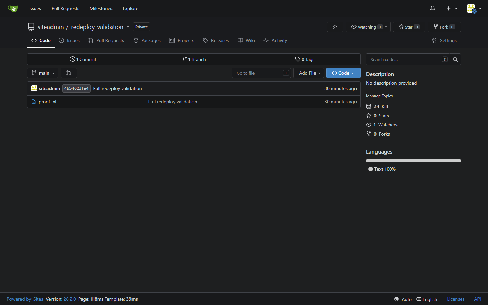
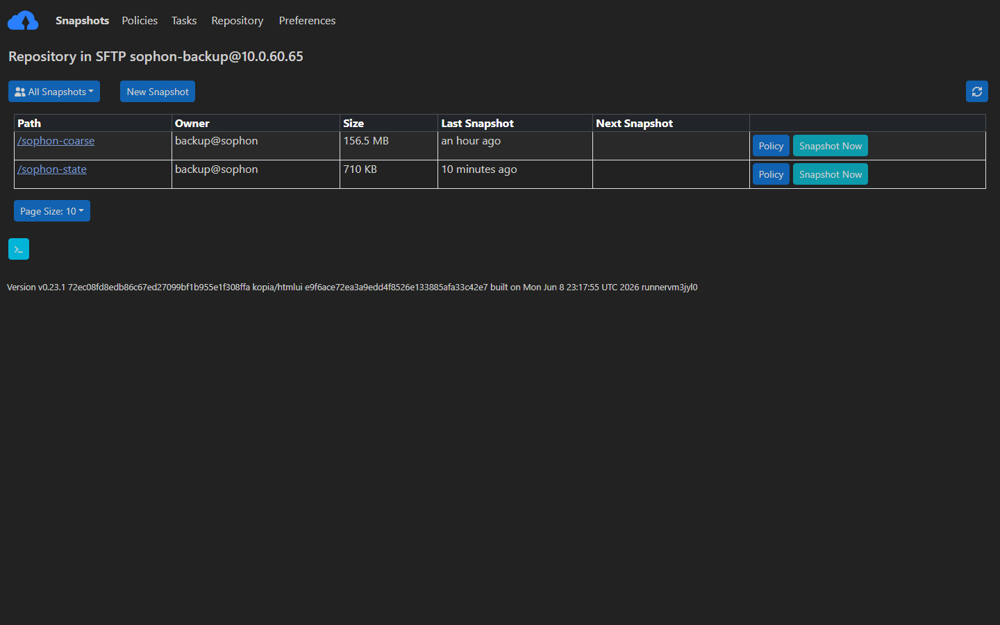
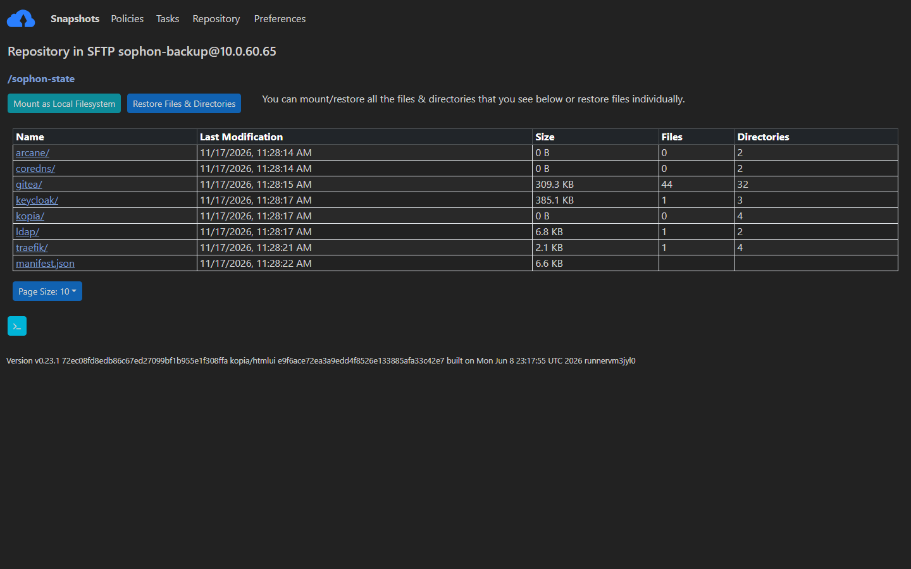

# Sophon Operations Guide

This guide covers the standard end-to-end workflow for deploying Sophon, verifying services, managing backups, and running disaster-recovery drills or production cutovers across Proxmox, VMware vCenter, and Microsoft Hyper-V.

- Need to set up the SFTP backup server manually or use an existing NAS/Linux host? See **[Manual & Custom SFTP Backup Server Setup](./manual-backup-server.md)**.
- Deploying without hypervisor API access or without an unattended secrets ISO? See **[Manual & Interactive InfraVM Installation and Recovery](./manual-installation.md)**.

---

## 1. Architecture Overview

Sophon runs on one **Fedora CoreOS** virtual machine (**InfraVM**) alongside an external SFTP backup server:

- **Immutable OS + persistent Btrfs storage:** Fedora CoreOS keeps the OS root read-only while storing container volumes on a persistent `/var` Btrfs partition so snapshots and restores can use fast copy-on-write reflinks.
- **Declarative rootless Podman stacks:** CoreDNS, Traefik, OpenLDAP, Keycloak, Gitea (with local file-backed Git LFS), Arcane, and Kopia run from Compose files in `/var/lib/sophon/stacks/`.
- **Arcane (`https://arcane.<domain>`):** OIDC-authenticated container management UI integrated with Keycloak (`arcane-admins` grants admin access).
- **Zero-downtime encrypted Kopia backups:**
  - **Primary backups (`/sophon-state`, default every `6h`):** Kopia's native scheduler and before/after snapshot actions capture hot database dumps (`pg_dumpall`, `pg_dump -Fc -Z0`, `slapcat`) via a restricted dump proxy and stage volume files (including Gitea Git + LFS data and TLS certificates) without stopping containers. Any container deployed via Gitea Actions can opt in with `sophon.backup.*` labels (see [`roles/kopia/README.md`](../roles/kopia/README.md)).
  - **Optional weekly Btrfs volume snapshots (`/sophon-coarse`, latest 4 kept):** Atomic read-only Btrfs subvolume snapshots uploaded weekly as a last-resort fallback.

> **Golden rule:** Nothing may exist only in the Arcane UI. Rebuilding a lost server is always **"deploy a clean VM from code, restore state from Kopia, and promote with `sophon-activate`"**, never restoring a full-disk VM image.

---

## 2. Configure `.env` & Build Media

On your workstation (with Docker or Podman installed), copy `.env.example` to `.env` and fill in your hypervisor and network settings:

```bash
cp .env.example .env              # Windows PowerShell: Copy-Item .env.example .env
```

Configure separate static IPv4 addresses and VM names for **production** and **dev / restore drills** in `.env` (each VM points to its own IP for split-horizon DNS):

```ini
SOPHON_HYPERVISOR=proxmox                 # proxmox | vcenter | hyperv
SOPHON_DOMAIN=sophon.example.com

# Production InfraVM
SOPHON_INFRAVM_NAME=sophon-infravm
SOPHON_NETWORK_CIDR=10.0.60.101/24
SOPHON_NETWORK_GATEWAY=10.0.60.1
SOPHON_VNET_DNS=1.1.1.1

# Dev / Restore-Drill InfraVM (`provision-dev` always replaces this VM; `sophon-activate` promotes it to prod IP)
SOPHON_DEV_INFRAVM_NAME=sophon-dev-infravm
SOPHON_DEV_NETWORK_CIDR=10.0.60.107/24

# Alpine SFTP Backup Server VM
SOPHON_BACKUP_NETWORK_CIDR=10.0.60.100/24
SOPHON_KOPIA_SFTP_HOST=10.0.60.100
```

*(See [`.env.example`](../.env.example) and [`docs/inputs.md`](./inputs.md) for hypervisor-specific fields. Leave passwords blank in `.env` if you prefer to be prompted interactively.)*

Then build the installation media and private mode-`0600` secrets ISOs:

```bash
# 1. Build OS, deployment, and alpine-sftp-server.iso media
bash sophon-provision.sh prepare                     # PowerShell: .\sophon-provision.ps1 prepare

# 2. (Air-gapped sites only) Pre-issue wildcard TLS certificate into artifacts/secrets/sophon-secrets.iso
bash sophon-provision.sh certificates issue --domain <your-domain>

# 3. Generate unattended secrets ISOs (`sophon-secrets.iso` + `sophon-backup-secrets.iso`)
bash sophon-provision.sh secrets --with-backup       # PowerShell: .\sophon-provision.ps1 secrets --with-backup
```

`secrets --with-backup` pre-pairs SSH host and client keys (`sophon-backup` for read-write production backups and `sophon-restore` for read-only standby drills) and writes `artifacts/secrets/sophon-secrets.iso` plus `artifacts/secrets/sophon-backup-secrets.iso`. Treat both files like passwords and delete them once your VMs are provisioned (or keep them solely on an encrypted admin workstation if running scheduled restore drills).

---

## 3. Deploy the Backup Server & Production InfraVM

Deploy the Alpine SFTP Backup Server VM (ideally on separate storage or a separate host from InfraVM) and then deploy the production InfraVM:

```bash
# 1. Deploy the Alpine SFTP Backup Server VM (`alpine-sftp-server.iso` + `sophon-backup-secrets.iso`)
bash sophon-provision.sh provision-backup            # PowerShell: .\sophon-provision.ps1 provision-backup

# 2. Deploy the production InfraVM (`sophon-infravm` on SOPHON_NETWORK_CIDR)
bash sophon-provision.sh provision                   # PowerShell: .\sophon-provision.ps1 provision
```

Both VMs install to disk, apply their static IPv4 settings and passwords, eject their secrets ISOs, and come up without console prompts:

- When `/repository` on the SFTP server is **empty**, `sophon-infravm` automatically initializes the encrypted Kopia repository, deploys all seven stacks (plus `cloudflared` when enabled), runs and verifies the first backup, enables the `6h` backup schedule, and marks the VM console banner as `DAY-1 DEPLOYMENT COMPLETE (ACTIVE PRODUCTION)`.
- When `/repository` **already contains snapshots**, InfraVM safely restores into **Safe Standby Mode** instead of overwriting backups or hijacking Cloudflare DNS (see [Section 6](#6-disaster-recovery--restore-drills)).

---

## 4. Access the Network & Verify Services

### 4.1 Reach the InfraVM network and configure client DNS

Depending on how your hypervisor VLANs are segmented, the subnet where you deployed InfraVM may not be directly routable from the laptop you used to talk to the hypervisor management API. Before opening the web UIs, make sure your client has a path to InfraVM's network—for example by:

- Connecting through an overlay network/VPN such as **Tailscale** or WireGuard,
- Moving your workstation onto that VLAN / swapping network cables, or
- Working from a privileged admin workstation VM inside that network.

Once on a reachable network, point DNS for your Sophon domain (`*.<domain>`) at InfraVM's IPv4 address (`SOPHON_NETWORK_CIDR`, or `SOPHON_DEV_NETWORK_CIDR` when testing a dev/drill VM); see [split-horizon DNS setup](../README.md#using-the-services).

### 4.2 Verify Arcane SSO & Gitea

1. Open `https://arcane.<domain>` and click **Keycloak**:


2. Sign in through `https://auth.<domain>` as a member of `arcane-admins` (for example `john.doe.admin`):


3. Open **Deploy -> Projects** (`https://arcane.<domain>/projects`) to confirm all seven Compose stacks are healthy:


*(Stacks with one-shot setup containers such as `gitea-init` and `traefik-init` normally show `Partially running` once those init containers exit `0`.)*

4. Open `https://git.<domain>` to verify Gitea SSO and repository/Git LFS hosting:



---

## 5. Backups & Kopia Web UI

### 5.1 Using the Kopia Web UI (`https://kopia.<domain>`)

Sign in at `https://kopia.<domain>` (`admin` by default) and switch the top-left filter from **Local Snapshots** to **All Snapshots** to view `/sophon-state` (and `/sophon-coarse` if enabled):



Click `/sophon-state` and choose any snapshot timestamp to browse directories or download individual files:



- **Supported in the Kopia Web UI:** Browsing snapshot history and sizes, downloading individual files, and clicking **Snapshot Now** on `/sophon-state` (which automatically runs Sophon's native before/after snapshot actions—hot database dumps, volume reflink staging, and cleanup).
- **Use the InfraVM CLI instead of the Web UI for:** Restoring containers (`sophon-restore` replays PostgreSQL/LDAP dumps and merges secrets; Kopia mounts `/volumes` read-only, so the UI **Restore** button cannot restore live containers) and changing snapshot policies (Sophon reconciles Kopia policies from code).

### 5.2 On-demand CLI snapshots & status checks

Logged into InfraVM as `core`, trigger an immediate snapshot or inspect the latest backup report with:

```bash
podman exec kopia kopia snapshot create /sophon-state
podman exec kopia cat /source/last-run.json
```

*(If weekly Btrfs volume snapshots are enabled via `SOPHON_KOPIA_COARSE_ENABLED=true`, check `/var/home/core/sophon-coarse/last-run.json`.)*

---

## 6. Disaster Recovery & Restore Drills

Sophon uses the same workflow for **routine restore drills** and **real disaster-recovery cutovers**: deploy a clean dev/standby VM from `sophon-secrets.iso`, verify the restored services on the dev IP, and—only when cutting over to production—run `sophon-activate`.

### 6.1 Deploy or refresh the dev / restore-drill InfraVM (`provision-dev`)

From your workstation, run one command:

```bash
bash sophon-provision.sh provision-dev               # PowerShell: .\sophon-provision.ps1 provision-dev
```

`provision-dev` automatically:
1. Stops and deletes any existing `SOPHON_DEV_INFRAVM_NAME` (`sophon-dev-infravm`) VM on Proxmox, vCenter, or Hyper-V (while refusing to touch `SOPHON_INFRAVM_NAME` or `sophon-backup`).
2. Configures the new VM with `SOPHON_DEV_NETWORK_CIDR` (using that dev IP as its own DNS address) and the confined read-only `sophon-restore` SFTP key, while keeping your production IP and `sophon-backup` credentials staged privately for optional promotion.
3. Installs CoreOS, deploys all stacks in **Safe Standby Mode** (Cloudflare tunnel disabled, Kopia `--readonly`, scheduled backups paused), runs `sophon-restore --snapshot latest --yes`, verifies all containers and HTTPS endpoints locally inside the guest, and sets the console banner to `STANDBY RESTORE COMPLETE`.

*(Append `--wait-https` if your workstation can reach `SOPHON_DEV_NETWORK_CIDR` over `:443` and you want the command to wait until external HTTPS checks pass.)*

- **For a restore drill:** You are done—inspect the VM console banner (or verify `https://arcane.<domain>` and `https://git.<domain>` against the dev IP) and leave it in Safe Standby Mode. To automate weekly drills on Linux, enable the user timer in [`contrib/systemd/`](../contrib/systemd):
  ```bash
  mkdir -p ~/.config/systemd/user
  cp contrib/systemd/sophon-verify-restore.{service,timer} ~/.config/systemd/user/
  systemctl --user daemon-reload
  systemctl --user enable --now sophon-verify-restore.timer
  ```

### 6.2 Promote to live production (`sophon-activate`)

When recovering from an actual production outage:

1. Shut down or delete the old broken production VM so its IP address is free.
2. SSH (or log in on the console) as `core` to the restored `sophon-dev-infravm` VM and run:
   ```bash
   sophon-activate
   ```
   `sophon-activate` switches the VM's static IPv4 address and self-pointing DNS (including CoreDNS, Podman network resolvers, and stack host mappings) from `SOPHON_DEV_NETWORK_CIDR` to `SOPHON_NETWORK_CIDR`, switches Kopia from read-only `sophon-restore` to read-write `sophon-backup`, enables `cloudflared` if configured, runs and verifies an immediate backup, and marks the server `ACTIVE PRODUCTION`. *(If connected over SSH on the dev IP, reconnect at the prod IP once `sophon-activate` switches the interface.)*

> **Alternative—replace the production VM directly in place:** If you prefer to rebuild `sophon-infravm` directly on `SOPHON_NETWORK_CIDR` instead of promoting `sophon-dev-infravm`, run `bash sophon-provision.sh provision --recreate` (which confirms, deletes `sophon-infravm`, and boots a fresh `sophon-infravm` into Safe Standby Mode), then log in as `core` and run `sophon-activate`.
>
> **Recovering without `sophon-secrets.iso`?** Follow [Interactive Disaster Recovery in Manual Installation](./manual-installation.md#3-interactive-disaster-recovery-without-sophon-secretsiso).


